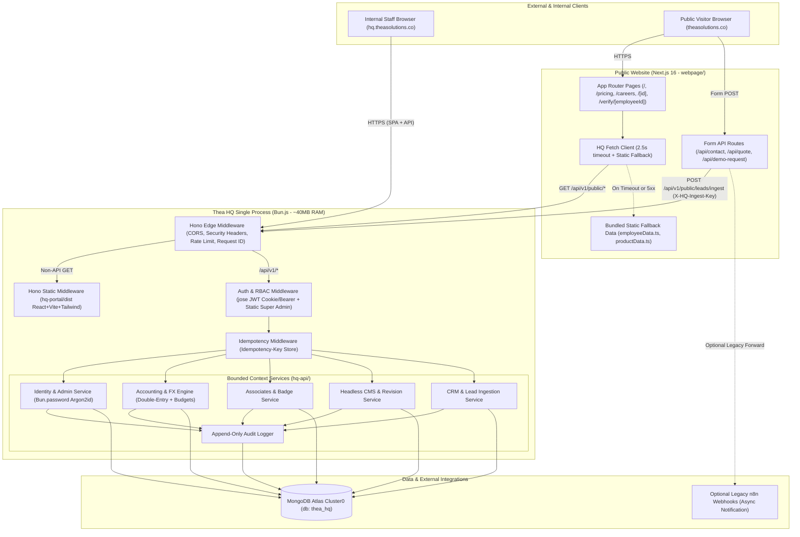
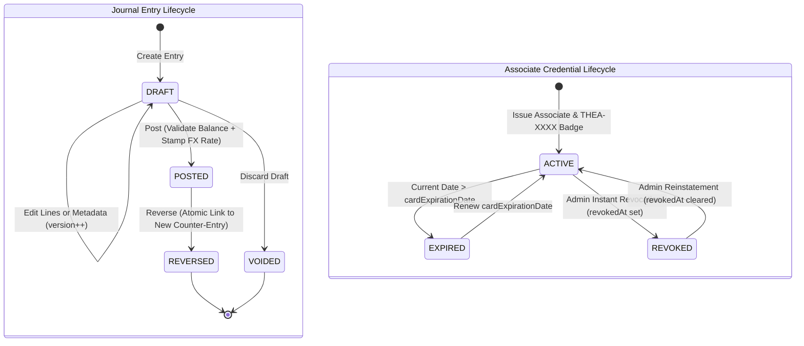
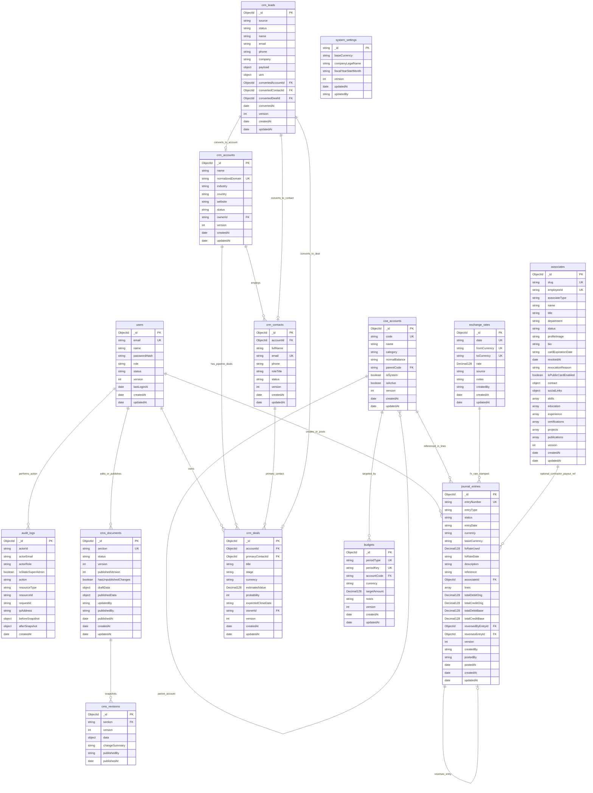
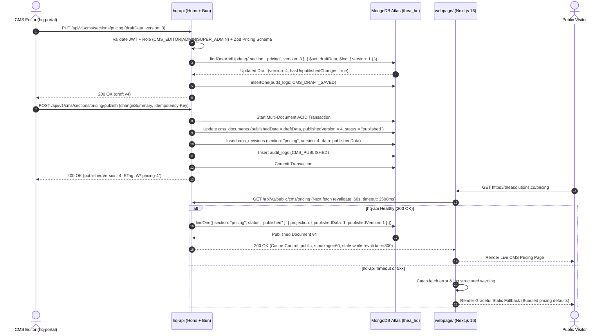
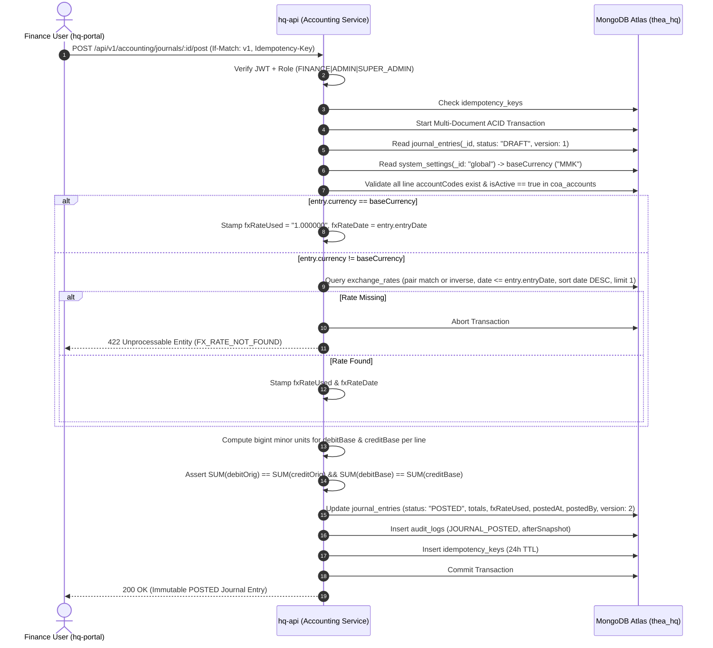

# Thea HQ (`hq.theasolutions.co`) — System Architecture Specification

## 1. Executive Summary & Architectural Principles

Thea HQ (`hq.theasolutions.co`) is the internal business operating portal, multi-currency double-entry accounting engine, contractor registry, CRM, and headless CMS powering Thea Solutions (`theasolutions.co`). The system runs as a single low-memory Bun.js process (`hq-api/`) that serves both the Hono REST API and the compiled React/Vite single-page application (`hq-portal/`), backed by MongoDB Atlas Cluster0 (`thea_hq` database).

### 1.1 Bounded Contexts (Domain-Driven Design)

The business domain is decomposed into six decoupled bounded contexts sharing a single MongoDB database with strict collection ownership:

| Bounded Context | Owning Collections | Core Responsibilities |
| :--- | :--- | :--- |
| **Identity & Access** | `users` (plus env Static Super Admin) | Sign-in authentication, Argon2id password hashing, `jose` JWT issuance, RBAC permission evaluation, user lifecycle management. |
| **Accounting & Multi-Currency** | `exchange_rates`, `coa_accounts`, `journal_entries`, `budgets` | Daily `THB`/`MMK` FX rates, 1000-6000 Chart of Accounts, immutable double-entry ledger with FX stamping, Budget vs. Actual variance, financial statements. |
| **Associates & Verification** | `associates` | Contractor-first directory (`contractor`, `freelancer`, `advisor`, `executive`) driving public digital business cards (`/[slug]`) and `THEA-XXXX` verification badges (`/verify/[employeeId]`). |
| **Headless Website CMS** | `cms_documents`, `cms_revisions` | Section-keyed JSON content management (`hero`, `services`, `delivery_pipeline`, `products`, `pricing`, `careers`, `faqs`, `site_settings`) with draft/published workflow and immutable revision history. |
| **CRM & Lead Ingestion** | `crm_leads`, `crm_accounts`, `crm_contacts`, `crm_deals` | Inbound lead capture from `theasolutions.co` forms, lead qualification, atomic conversion to Accounts/Contacts/Deals, pipeline stage tracking. |
| **Governance & Platform** | `system_settings`, `audit_logs`, `idempotency_keys` | Base reporting currency configuration, append-only audit trail across all mutating actions, HTTP idempotency enforcement. |

### 1.2 Clean Architecture Layering (`hq-api/`)

Each bounded context follows a strict four-layer dependency rule where inner layers never import outer layers:

1. **Domain Layer (`src/domain/<context>/`)**: Pure TypeScript entities, value objects (fixed-scale decimal money, `THEA-XXXX` badge IDs, balanced journal invariants), and domain errors. Zero framework or driver imports.
2. **Application Layer (`src/application/<context>/`)**: Use cases, Zod input/output DTO schemas, transaction orchestration, and repository interfaces.
3. **Infrastructure Layer (`src/infrastructure/`)**: Official `mongodb` driver connection pool, collection repository implementations, `Bun.password` Argon2id adapter, `jose` JWT signer/verifier, and audit log writer.
4. **Interface Layer (`src/interfaces/http/`)**: Hono route handlers, authentication/RBAC middleware, idempotency middleware, rate limiter, RFC 7807 error serializer, and static file server for `hq-portal/dist`.

### 1.3 Runtime & Memory Budget

- **Production Footprint**: Single Bun.js runtime process (~40 MB RSS) serving `/api/v1/*` via Hono and serving `hq-portal/dist/*` with SPA history fallback for all non-API GET routes.
- **Local Development**: `hq-api` listens on `http://localhost:4000`; Vite dev server (`hq-portal`) listens on `http://localhost:5173` and proxies `/api/*` requests to `http://localhost:4000`; Next.js (`webpage`) listens on `http://localhost:3000` and reads from `HQ_API_BASE_URL`.

---

## 2. System Topology & Component Flow



---

## 3. Domain Lifecycles & State Transitions

### 3.1 Journal Entry & Associate Verification States



### 3.2 CMS Document Publishing States

- **`draft`**: Editable working payload stored in `cms_documents`. Never exposed on `/api/v1/public/cms/*` unless the document already holds a separate `publishedData` snapshot.
- **`published`**: Live state where `publishedData` matches the promoted draft snapshot, `publishedVersion` increments monotonically, and a frozen copy is appended to `cms_revisions`. Editing a published section mutates `draftData` and sets `hasUnpublishedChanges: true` without altering live public responses until an explicit publish call occurs.

---

## 4. Database Architecture (MongoDB Atlas Cluster0 — `thea_hq`)

Connection configuration is read exclusively from the `MONGODB_URI` environment variable (database name `thea_hq`, configurable via `MONGODB_DB_NAME` defaulting to `thea_hq`). No credentials or Atlas hostnames are ever committed to documentation or source control.

### 4.1 Entity-Relationship Diagram



### 4.2 Numeric Precision & Currency Invariants

IEEE-754 floating-point numbers are prohibited for monetary calculations and FX rate arithmetic.

- **MongoDB Storage**: All monetary fields (`debitOrig`, `creditOrig`, `debitBase`, `creditBase`, `totalDebitOrig`, `totalCreditOrig`, `totalDebitBase`, `totalCreditBase`, `targetAmount`, `estimatedValue`) and FX rates (`rate`, `fxRateUsed`) are stored as BSON `Decimal128`.
- **Domain Arithmetic**: Inside `hq-api`, amounts are parsed into `bigint` minor units (scale `10^2`, i.e., 2 decimal places) and FX rates into `bigint` micro-units (scale `10^6`, i.e., 6 decimal places) using half-even rounding during conversion.
- **API Wire Format**: Monetary values and FX rates are serialized and accepted as fixed-scale decimal strings (e.g., `"135.000000"` for FX rates, `"2500000.00"` for amounts) validated by strict Zod regex patterns.
- **Supported Currencies**: Enum `['MMK', 'THB']`. Default `system_settings.baseCurrency` is `'MMK'`, configurable to `'THB'` by `SUPER_ADMIN` or `ADMIN`.
- **FX Rate Direction & Resolution**:
  - Daily rates are entered primarily as `fromCurrency: 'THB'`, `toCurrency: 'MMK'` (e.g., `1 THB = 135.00 MMK`).
  - When `currency === baseCurrency`, `fxRateUsed` is stamped as `"1.000000"` and `fxRateDate` equals `entryDate`.
  - When `currency !== baseCurrency`, the engine looks up the exact rate for `(entryDate, currency, baseCurrency)`; if no direct pair exists, it resolves the inverse pair `(entryDate, baseCurrency, currency)` as `1 / rate` rounded to 6 decimal places. If no rate exists for `entryDate`, the engine falls back to the latest rate with `date <= entryDate` and stamps that actual `fxRateDate` on the journal entry (unless `strictFxDate: true` is passed, which rejects with `422`).

### 4.3 Collection Schemas, Validation Rules & Indexes

All collections enforce MongoDB server-side `$jsonSchema` validation (`validationLevel: "strict"`, `validationAction: "error"`) configured via an idempotent startup migration script (`hq-api/src/infrastructure/db/migrations.ts`).

#### 1. `users`
Stores database-backed internal staff accounts. The Static Super Admin does not require a record in this collection.

```json
{
  "_id": "ObjectId",
  "email": "finance@theasolutions.co",
  "name": "Finance Lead",
  "passwordHash": "$argon2id$v=19$...",
  "role": "FINANCE",
  "status": "ACTIVE",
  "version": 1,
  "lastLoginAt": "ISODate | null",
  "createdBy": "static-super-admin | ObjectIdString",
  "createdAt": "ISODate",
  "updatedAt": "ISODate"
}
```
- **Validation Invariants**:
  - `email`: lowercase trimmed string, valid email format, required.
  - `role`: enum `["ADMIN", "FINANCE", "CMS_EDITOR", "CRM_MANAGER", "VIEWER"]` (`SUPER_ADMIN` cannot be persisted to DB; reserved strictly for Static Super Admin env identity).
  - `status`: enum `["ACTIVE", "DISABLED"]`.
  - `version`: integer >= 1.
- **Indexes**:
  - `uq_users_email`: `{ email: 1 }` (`unique: true`).
  - `idx_users_role_status`: `{ role: 1, status: 1 }`.

#### 2. `system_settings`
Singleton document (`_id: "global"`) controlling workspace-wide behavior.

```json
{
  "_id": "global",
  "baseCurrency": "MMK",
  "companyLegalName": "Thea Solutions",
  "fiscalYearStartMonth": 1,
  "defaultBadgeValidityDays": 365,
  "version": 1,
  "updatedBy": "static-super-admin",
  "updatedAt": "ISODate"
}
```
- **Validation Invariants**:
  - `baseCurrency`: enum `["MMK", "THB"]`.
  - `fiscalYearStartMonth`: integer between `1` and `12`.
- **Indexes**: Default `_id` primary index only.

#### 3. `audit_logs`
Append-only immutable audit log. Application database role only performs `insertOne` and `find` on this collection; no update or delete endpoints exist.

```json
{
  "_id": "ObjectId",
  "actorId": "static-super-admin | ObjectIdString",
  "actorEmail": "boss@theasolutions.co",
  "actorRole": "SUPER_ADMIN",
  "isStaticSuperAdmin": true,
  "action": "JOURNAL_POSTED",
  "resourceType": "journal_entry",
  "resourceId": "674...",
  "requestId": "uuid-v4",
  "ipAddress": "203.0.113.10",
  "userAgent": "Mozilla/5.0 ...",
  "beforeSnapshot": {},
  "afterSnapshot": {},
  "createdAt": "ISODate"
}
```
- **Indexes**:
  - `idx_audit_created_id`: `{ createdAt: -1, _id: -1 }` (keyset pagination).
  - `idx_audit_resource`: `{ resourceType: 1, resourceId: 1, createdAt: -1 }`.
  - `idx_audit_actor`: `{ actorId: 1, createdAt: -1 }`.
  - `idx_audit_action`: `{ action: 1, createdAt: -1 }`.

#### 4. `exchange_rates`
Daily FX rate ledger for `THB` and `MMK`.

```json
{
  "_id": "ObjectId",
  "date": "2026-11-25",
  "fromCurrency": "THB",
  "toCurrency": "MMK",
  "rate": "Decimal128('135.000000')",
  "source": "Market Reference / Bank Desk",
  "notes": "Morning mid-market rate",
  "createdBy": "ObjectIdString",
  "createdAt": "ISODate",
  "updatedAt": "ISODate"
}
```
- **Validation Invariants**:
  - `date`: regex `^\d{4}-\d{2}-\d{2}$`.
  - `fromCurrency`, `toCurrency`: enum `["MMK", "THB"]`, invariant `fromCurrency !== toCurrency`.
  - `rate`: `Decimal128 > 0`.
- **Indexes**:
  - `uq_fx_date_pair`: `{ date: 1, fromCurrency: 1, toCurrency: 1 }` (`unique: true`).
  - `idx_fx_pair_date_desc`: `{ fromCurrency: 1, toCurrency: 1, date: -1 }` (fast latest-rate lookup for `date <= entryDate`).

#### 5. `coa_accounts`
Hierarchical Chart of Accounts organized into six standard numeric blocks.

```json
{
  "_id": "ObjectId",
  "code": "5100",
  "name": "Engineering Contractor Fees",
  "category": "COGS",
  "normalBalance": "DEBIT",
  "parentCode": "5000",
  "description": "Direct project payouts to external engineering contractors",
  "isSystem": true,
  "isActive": true,
  "version": 1,
  "createdAt": "ISODate",
  "updatedAt": "ISODate"
}
```
- **Seed Hierarchy (Standard Blocks)**:
  - `1000` **Assets** (`category: "ASSET"`, `normalBalance: "DEBIT"`): `1010` Cash on Hand (MMK), `1020` Bank Account (MMK), `1030` Bank Account (THB), `1100` Accounts Receivable, `1200` Prepaid Expenses, `1500` Computer & Equipment Assets.
  - `2000` **Liabilities** (`category: "LIABILITY"`, `normalBalance: "CREDIT"`): `2010` Contractor Payables, `2100` Accrued Expenses, `2200` Client Retainer Deposits / Unearned Revenue, `2300` Tax Payables.
  - `3000` **Equity** (`category: "EQUITY"`, `normalBalance: "CREDIT"`): `3010` Founder Capital, `3100` Retained Earnings, `3200` Owner Drawings.
  - `4000` **Revenue** (`category: "REVENUE"`, `normalBalance: "CREDIT"`): `4010` Custom Software Engineering Revenue, `4020` AI & Automation Retainer Revenue, `4030` Consulting & Advisory Revenue, `4090` FX Gain.
  - `5000` **Direct Contractor Costs / COGS** (`category: "COGS"`, `normalBalance: "DEBIT"`): `5010` Engineering Contractor Payouts, `5020` Design & Product Freelancer Payouts, `5030` Project Cloud & API Usage Costs, `5040` Third-Party Software Subcontractors.
  - `6000` **Operating Expenses** (`category: "OPEX"`, `normalBalance: "DEBIT"`): `6010` SaaS & Developer Tooling, `6020` Internal Cloud Hosting & Domains, `6030` Marketing & Lead Generation, `6040` Legal, Accounting & Advisory, `6050` Office & Remote Stipends, `6060` Bank Charges & Transfer Fees, `6090` FX Loss.
- **Validation Invariants**:
  - `code`: regex `^[1-6]\d{3}$`.
  - `category`: enum `["ASSET", "LIABILITY", "EQUITY", "REVENUE", "COGS", "OPEX"]`.
  - `normalBalance`: `ASSET | COGS | OPEX -> DEBIT`; `LIABILITY | EQUITY | REVENUE -> CREDIT`.
  - Accounts referenced by any `POSTED` journal entry cannot be deleted; they may only be marked `isActive: false`.
- **Indexes**:
  - `uq_coa_code`: `{ code: 1 }` (`unique: true`).
  - `idx_coa_category_code`: `{ category: 1, code: 1 }`.
  - `idx_coa_parent`: `{ parentCode: 1 }`.

#### 6. `journal_entries`
Immutable double-entry ledger supporting `INCOME`, `EXPENSE`, and `GENERAL` entries with dual-currency stamping.

```json
{
  "_id": "ObjectId",
  "entryNumber": "JE-2026-000042",
  "entryType": "EXPENSE",
  "status": "POSTED",
  "entryDate": "2026-11-25",
  "currency": "THB",
  "baseCurrency": "MMK",
  "fxRateUsed": "Decimal128('135.000000')",
  "fxRateDate": "2026-11-25",
  "description": "November sprint payout to contractor",
  "reference": "INV-CON-2026-118",
  "associateId": "ObjectId | null",
  "lines": [
    {
      "lineNo": 1,
      "accountCode": "5010",
      "accountNameSnapshot": "Engineering Contractor Payouts",
      "memo": "Backend sprint delivery",
      "debitOrig": "Decimal128('20000.00')",
      "creditOrig": "Decimal128('0.00')",
      "debitBase": "Decimal128('2700000.00')",
      "creditBase": "Decimal128('0.00')"
    },
    {
      "lineNo": 2,
      "accountCode": "1030",
      "accountNameSnapshot": "Bank Account (THB)",
      "memo": "KBank wire transfer",
      "debitOrig": "Decimal128('0.00')",
      "creditOrig": "Decimal128('20000.00')",
      "debitBase": "Decimal128('0.00')",
      "creditBase": "Decimal128('2700000.00')"
    }
  ],
  "totalDebitOrig": "Decimal128('20000.00')",
  "totalCreditOrig": "Decimal128('20000.00')",
  "totalDebitBase": "Decimal128('2700000.00')",
  "totalCreditBase": "Decimal128('2700000.00')",
  "reversedByEntryId": "ObjectId | null",
  "reversesEntryId": "ObjectId | null",
  "version": 2,
  "createdBy": "ObjectIdString",
  "postedBy": "ObjectIdString",
  "postedAt": "ISODate",
  "createdAt": "ISODate",
  "updatedAt": "ISODate"
}
```
- **Validation Invariants**:
  - `lines.length >= 2`.
  - Every line has strictly one non-zero side (`(debitOrig > 0 && creditOrig === 0) || (creditOrig > 0 && debitOrig === 0)`).
  - Double-entry balance in original currency: `SUM(lines.debitOrig) === SUM(lines.creditOrig) > 0`.
  - Double-entry balance in base currency: `SUM(lines.debitBase) === SUM(lines.creditBase) > 0` (any 1-minor-unit rounding remainder from line-by-line FX multiplication is explicitly checked and adjusted on the largest opposing balancing line or rejected if drift exceeds `lines.length` minor units).
  - Every `lines[].accountCode` must exist in `coa_accounts` with `isActive: true` at posting time.
  - Immutability: Once `status === "POSTED"`, no field except `status -> "REVERSED"`, `reversedByEntryId`, `version`, and `updatedAt` may ever be modified.
- **Indexes**:
  - `uq_je_entry_number`: `{ entryNumber: 1 }` (`unique: true`).
  - `idx_je_status_date_id`: `{ status: 1, entryDate: -1, _id: -1 }` (keyset pagination & financial reports).
  - `idx_je_lines_account_status_date`: `{ "lines.accountCode": 1, status: 1, entryDate: 1 }` (General Ledger, Trial Balance, and Budget vs. Actual aggregation).
  - `idx_je_type_date`: `{ entryType: 1, entryDate: -1 }`.
  - `idx_je_associate`: `{ associateId: 1, entryDate: -1 }` (`sparse: true`).

#### 7. `budgets`
Maps monthly or quarterly budget targets to Chart of Accounts codes for Budget vs. Actual variance reporting.

```json
{
  "_id": "ObjectId",
  "periodType": "MONTHLY",
  "periodKey": "2026-11",
  "accountCode": "5010",
  "currency": "MMK",
  "targetAmount": "Decimal128('15000000.00')",
  "notes": "Q4 sprint engineering contractor allocation",
  "version": 1,
  "createdBy": "ObjectIdString",
  "createdAt": "ISODate",
  "updatedAt": "ISODate"
}
```
- **Validation Invariants**:
  - `periodType`: enum `["MONTHLY", "QUARTERLY"]`.
  - `periodKey`: `YYYY-MM` when `MONTHLY`; `YYYY-Q[1-4]` when `QUARTERLY`.
  - `targetAmount >= 0`.
  - **Variance Formula**:
    - For `REVENUE` accounts: `actualBase = SUM(creditBase - debitBase)`; `variance = actualBase - targetBase` (positive is favorable).
    - For `COGS` and `OPEX` accounts: `actualBase = SUM(debitBase - creditBase)`; `variance = targetBase - actualBase` (positive is under-budget / favorable).
- **Indexes**:
  - `uq_budget_period_account`: `{ periodType: 1, periodKey: 1, accountCode: 1 }` (`unique: true`).
  - `idx_budget_period_key`: `{ periodKey: 1, accountCode: 1 }`.

#### 8. `associates`
Contractor-first unified directory powering both `theasolutions.co/[slug]` digital business cards and `theasolutions.co/verify/THEA-XXXX` credential badges.

```json
{
  "_id": "ObjectId",
  "slug": "dr-ohnmar-than",
  "employeeId": "THEA-XWUE",
  "associateType": "executive",
  "name": "Dr. Ohnmar Than",
  "title": "Chief Financial Officer",
  "department": "Finance",
  "status": "ACTIVE",
  "profileImage": "https://live.staticflickr.com/...",
  "bio": "Experienced Chief Financial Officer...",
  "cardExpirationDate": "2027-12-31",
  "revokedAt": null,
  "revocationReason": null,
  "isPublicCardEnabled": true,
  "contact": {
    "email": "ohnmarthan@theasolutions.co",
    "phone": "",
    "location": "Yangon, Myanmar"
  },
  "socialLinks": {
    "linkedin": "",
    "github": "",
    "twitter": "",
    "website": ""
  },
  "skills": ["Financial Strategy", "Risk Management"],
  "education": [
    {
      "degree": "PhD in Medical Laboratory Technology",
      "institution": "University of Medical Technology, Yangon",
      "location": "Yangon, Myanmar",
      "startDate": "2020",
      "endDate": "2023",
      "description": "..."
    }
  ],
  "experience": [
    {
      "position": "Chief Financial Officer",
      "company": "Thea Solutions",
      "location": "Yangon, Myanmar",
      "startDate": "2026",
      "endDate": "Present",
      "current": true,
      "description": ["Oversee financial planning and analysis"]
    }
  ],
  "certifications": [
    {
      "name": "Cert Name",
      "issuer": "Issuer",
      "date": "2025",
      "credentialUrl": "https://..."
    }
  ],
  "projects": [
    {
      "name": "Project Name",
      "description": "Summary",
      "technologies": ["TypeScript", "MongoDB"],
      "url": "https://..."
    }
  ],
  "publications": [
    {
      "title": "Paper Title",
      "type": "Article",
      "date": "October 2023",
      "authors": ["Ohnmar Than"],
      "description": "Abstract",
      "url": "https://..."
    }
  ],
  "internalNotes": "Contract renewal due Q4",
  "version": 1,
  "createdAt": "ISODate",
  "updatedAt": "ISODate"
}
```
- **Validation Invariants**:
  - `slug`: lowercase alphanumeric with hyphens (`^[a-z0-9]+(?:-[a-z0-9]+)*$`), cannot collide with reserved Next.js public routes (`about`, `ai`, `api`, `careers`, `contact`, `pricing`, `schedule-demo`, `verify`).
  - `employeeId`: regex `^THEA-[A-Z0-9]{4}$` (auto-generated with collision retry if omitted).
  - `associateType`: enum `["contractor", "freelancer", "advisor", "executive"]` (no W-2 employee type).
  - `status`: enum `["ACTIVE", "INACTIVE", "REVOKED"]`.
  - **Verification Computation** (server-authoritative on `/api/v1/public/verify/:employeeId`):
    - If `status === "REVOKED"` or `revokedAt !== null` -> `verificationStatus: "revoked"`, `isVerified: false`.
    - Else if `todayUTC > cardExpirationDate` -> `verificationStatus: "expired"`, `isVerified: false`.
    - Else if `status === "ACTIVE"` -> `verificationStatus: "verified"`, `isVerified: true`.
  - Public endpoints strip `internalNotes`, `revocationReason`, and administrative metadata.
- **Indexes**:
  - `uq_associates_slug`: `{ slug: 1 }` (`unique: true`).
  - `uq_associates_employee_id`: `{ employeeId: 1 }` (`unique: true`).
  - `idx_associates_status_type`: `{ status: 1, associateType: 1, name: 1 }`.

#### 9. `cms_documents`
Headless CMS section documents synced to `theasolutions.co`.

```json
{
  "_id": "ObjectId",
  "section": "pricing",
  "status": "published",
  "version": 4,
  "publishedVersion": 4,
  "hasUnpublishedChanges": false,
  "draftData": {
    "eyebrow": "Transparent Engagement · Zero Hidden Fees",
    "headline": "Predictable investment models aligned with measurable outcomes",
    "engagementModels": []
  },
  "publishedData": {
    "eyebrow": "Transparent Engagement · Zero Hidden Fees",
    "headline": "Predictable investment models aligned with measurable outcomes",
    "engagementModels": []
  },
  "updatedBy": "ObjectIdString",
  "publishedBy": "ObjectIdString",
  "publishedAt": "ISODate",
  "createdAt": "ISODate",
  "updatedAt": "ISODate"
}
```
- **Allowed `section` Keys**: Enum `["hero", "services", "delivery_pipeline", "products", "pricing", "careers", "faqs", "site_settings"]`.
- **Section-Specific Zod Payload Contracts**:
  - `hero`: eyebrow, headline, subheadline, primaryCta, trustBullets, videoPosterUrl.
  - `services`: eyebrow, headline, intro, items (`tag`, `title`, `description`).
  - `delivery_pipeline`: eyebrow, headline, phases (`step`, `tag`, `title`, `timeframe`, `summary`, `businessOutcome`, `deliverables[]`, `touchpoint`, `iconKey`).
  - `products`: categories (`corporate-agents`, `corporate-intelligence`, `legal-compliance-intelligence`, `actions`), items (`id`, `name`, `category`, `subCategory`, `description`, `features[]`, `targetAudience[]`, `jurisdictions[]`, `demoAvailable`).
  - `pricing`: eyebrow, headline, intro, engagementModels (`name`, `eyebrow`, `tagline`, `timeline`, `features[]`, `actionText`, `popular`).
  - `careers`: headline, intro, openings (`title`, `level`, `team`, `location`, `type`, `description`, `skills[]`, `focus[]`, `isOpen`).
  - `faqs`: items (`question`, `answer`, `category`, `sortOrder`).
  - `site_settings`: contactEmail, salesPhone, locations[], socialLinks, announcementBanner, seoDefaults.
- **Indexes**:
  - `uq_cms_section`: `{ section: 1 }` (`unique: true`).
  - `idx_cms_status`: `{ status: 1 }`.

#### 10. `cms_revisions`
Immutable historical snapshots written atomically whenever a CMS section is published or rolled back.

```json
{
  "_id": "ObjectId",
  "section": "pricing",
  "version": 4,
  "data": {},
  "changeSummary": "Updated Dedicated Engineering Pod feature list",
  "publishedBy": "ObjectIdString",
  "publishedAt": "ISODate"
}
```
- **Indexes**:
  - `uq_cms_rev_section_version`: `{ section: 1, version: -1 }` (`unique: true`).

#### 11. `crm_accounts`
Client and prospect organizations.

```json
{
  "_id": "ObjectId",
  "name": "MediTrust Diagnostics",
  "normalizedDomain": "meditrust.example",
  "industry": "Healthcare Diagnostics",
  "country": "MM",
  "website": "https://meditrust.example",
  "status": "PROSPECT",
  "ownerId": "ObjectIdString | null",
  "notes": "Interested in LIMS + Inventory automation",
  "version": 1,
  "createdAt": "ISODate",
  "updatedAt": "ISODate"
}
```
- **Validation Invariants**: `status` enum `["PROSPECT", "ACTIVE_CLIENT", "PAST_CLIENT", "CHURNED"]`.
- **Indexes**:
  - `uq_crm_accounts_domain`: `{ normalizedDomain: 1 }` (`unique: true`, `partialFilterExpression: { normalizedDomain: { $type: "string", $gt: "" } }`).
  - `idx_crm_accounts_status_created`: `{ status: 1, createdAt: -1, _id: -1 }`.

#### 12. `crm_contacts`
Individual stakeholders linked to a CRM account.

```json
{
  "_id": "ObjectId",
  "accountId": "ObjectId | null",
  "fullName": "Aung Kyaw",
  "email": "aung@meditrust.example",
  "phone": "+959...",
  "roleTitle": "Operations Director",
  "status": "ACTIVE",
  "version": 1,
  "createdAt": "ISODate",
  "updatedAt": "ISODate"
}
```
- **Indexes**:
  - `uq_crm_contacts_email`: `{ email: 1 }` (`unique: true`, lowercase normalized).
  - `idx_crm_contacts_account`: `{ accountId: 1, fullName: 1 }`.

#### 13. `crm_deals`
Sales pipeline opportunities tracked in `MMK` or `THB`.

```json
{
  "_id": "ObjectId",
  "accountId": "ObjectId",
  "primaryContactId": "ObjectId | null",
  "title": "LIMS & Cold-Chain Inventory Modernization",
  "stage": "PROPOSAL",
  "currency": "THB",
  "estimatedValue": "Decimal128('450000.00')",
  "probability": 60,
  "expectedCloseDate": "2027-01-31",
  "ownerId": "ObjectIdString | null",
  "lostReason": null,
  "version": 1,
  "createdAt": "ISODate",
  "updatedAt": "ISODate"
}
```
- **Validation Invariants**:
  - `stage`: enum `["DISCOVERY", "SCOPING", "PROPOSAL", "NEGOTIATION", "WON", "LOST"]`.
  - `currency`: enum `["MMK", "THB"]`.
  - `probability`: integer `0..100`.
- **Indexes**:
  - `idx_crm_deals_stage_updated`: `{ stage: 1, updatedAt: -1, _id: -1 }`.
  - `idx_crm_deals_account`: `{ accountId: 1, createdAt: -1 }`.

#### 14. `crm_leads`
Inbound leads captured from `theasolutions.co` (`/api/contact`, `/api/quote`, `/api/demo-request`) or created manually inside Thea HQ.

```json
{
  "_id": "ObjectId",
  "source": "WEB_DEMO_REQUEST",
  "status": "NEW",
  "name": "Min Thu",
  "email": "minthu@acme.example",
  "phone": "+959...",
  "company": "Acme Trading",
  "payload": {
    "serviceType": "Intelligent Process Automation",
    "projectDescription": "ERP integration",
    "budgetRange": "$15k-$30k",
    "timeline": "Q1 2027",
    "scheduledDate": "2026-12-01",
    "scheduledTime": "14:00",
    "productId": "thea-finance",
    "productName": "Thea Finance",
    "productCategory": "corporate-agents",
    "businessDomain": "Distribution"
  },
  "utm": {
    "source": "linkedin",
    "medium": "social",
    "campaign": "q4-launch",
    "referrer": "https://..."
  },
  "convertedAccountId": "ObjectId | null",
  "convertedContactId": "ObjectId | null",
  "convertedDealId": "ObjectId | null",
  "convertedAt": "ISODate | null",
  "version": 1,
  "createdAt": "ISODate",
  "updatedAt": "ISODate"
}
```
- **Validation Invariants**:
  - `source`: enum `["WEB_CONTACT", "WEB_QUOTE", "WEB_DEMO_REQUEST", "MANUAL", "REFERRAL"]`.
  - `status`: enum `["NEW", "CONTACTED", "QUALIFIED", "CONVERTED", "DISQUALIFIED"]`.
- **Indexes**:
  - `idx_crm_leads_status_created`: `{ status: 1, createdAt: -1, _id: -1 }`.
  - `idx_crm_leads_source_created`: `{ source: 1, createdAt: -1 }`.
  - `idx_crm_leads_email`: `{ email: 1, createdAt: -1 }`.

#### 15. `idempotency_keys`
Prevents duplicate execution of financial postings, reversals, and webhook lead ingestion retries.

```json
{
  "_id": "string (scoped: actorId + ':' + route + ':' + idempotencyKey)",
  "requestHash": "sha256-hex",
  "statusCode": 201,
  "responseBody": {},
  "createdAt": "ISODate",
  "expiresAt": "ISODate"
}
```
- **Indexes**:
  - `ttl_idempotency_expires`: `{ expiresAt: 1 }` (`expireAfterSeconds: 0`, 24-hour TTL).

### 4.4 Cursor Pagination Contract

Unbounded `.skip()` scans are prohibited on list collections (`journal_entries`, `audit_logs`, `crm_leads`, `crm_deals`, `crm_accounts`, `crm_contacts`, `associates`, `exchange_rates`).

- Clients pass `?limit=25` (max `100`) and optional `?cursor=<base64url(JSON)>`.
- Cursor encodes `{ s: <lastSortValue>, id: <lastObjectIdHex> }`.
- Repository queries apply strict keyset predicates: `{ $or: [ { [sortField]: { $lt: cursor.s } }, { [sortField]: cursor.s, _id: { $lt: ObjectId(cursor.id) } } ] }` (flipped to `$gt` for ascending order).
- List responses return `{ items: T[], nextCursor: string | null, hasMore: boolean }`.

---

## 5. Distributed Interaction Sequences

### 5.1 CMS Publish to Public Website (`theasolutions.co`) Sync



### 5.2 Double-Entry Journal Posting with FX Stamping



---

## 6. Authentication, Static Super Admin, and Security Controls

### 6.1 Sign-In Only Authentication

Self-registration, public password resets, and MFA are intentionally omitted in Phase 1. Every portal account is provisioned either via environment variables (Static Super Admin) or inside `/admin` by an authenticated `SUPER_ADMIN` or `ADMIN`.

1. **Static Super Admin ("Final Boss")**:
   - Configured via `SUPER_ADMIN_EMAIL`, `SUPER_ADMIN_PASSWORD`, and `SUPER_ADMIN_NAME` environment variables.
   - `hq-api` fails fast on boot if `SUPER_ADMIN_EMAIL`, `SUPER_ADMIN_PASSWORD` (minimum 16 characters in production), `JWT_SECRET` (minimum 32 random bytes), or `MONGODB_URI` are absent.
   - During `POST /api/v1/auth/login`, the submitted email (lowercased, trimmed) and password are compared against `SUPER_ADMIN_EMAIL` and `SUPER_ADMIN_PASSWORD` using constant-time SHA-256 digest comparison (`crypto.timingSafeEqual`) so timing side channels cannot reveal password length or prefix matches.
   - Upon match, `hq-api` issues a JWT with `{ sub: "static-super-admin", email, name, role: "SUPER_ADMIN", isStaticSuperAdmin: true }` without querying the `users` collection.
   - `SUPER_ADMIN` bypasses every RBAC permission gate (`*`) and cannot be disabled or modified through `/api/v1/admin/users`.
2. **Database Internal Users (`users` collection)**:
   - Passwords are hashed using native `Bun.password.hash(plain, { algorithm: "argon2id", memoryCost: 65536, timeCost: 2 })` and verified via `Bun.password.verify`.
   - Accounts with `status === "DISABLED"` are rejected with `403 Forbidden` at login and during token refresh/validation checks.
3. **JWT Transport & Session Policy (`jose`)**:
   - Signed with HS256 using `JWT_SECRET` (`iss: "hq.theasolutions.co"`, `aud: "thea-hq-api"`, `exp: "8h"`).
   - Delivered as an HTTP-only cookie (`thea_hq_session`; `HttpOnly; SameSite=Lax; Path=/`; `Secure` enabled in production) and also accepted via `Authorization: Bearer <token>` for programmatic clients and API tests.
   - Logout (`POST /api/v1/auth/logout`) clears the cookie (`Max-Age=0`) and records an audit entry.

### 6.2 Role-Based Access Control (RBAC) Matrix

| Capability / Module | `SUPER_ADMIN` (`*`) | `ADMIN` | `FINANCE` | `CMS_EDITOR` | `CRM_MANAGER` | `VIEWER` |
| :--- | :---: | :---: | :---: | :---: | :---: | :---: |
| Auth (`login`, `logout`, `me`) | Allow | Allow | Allow | Allow | Allow | Allow |
| Accounting: View COA, FX, Journals, Budgets, Reports | Allow | Allow | Allow | Deny | Deny | Allow (Read) |
| Accounting: Create/Edit/Post/Reverse Journals, FX, Budgets, COA | Allow | Allow | Allow | Deny | Deny | Deny |
| Associates: View Directory | Allow | Allow | Allow | Allow | Allow | Allow |
| Associates: Create/Edit/Revoke/Reinstate | Allow | Allow | Deny | Allow | Deny | Deny |
| CMS: View Sections & Revisions | Allow | Allow | Deny | Allow | Deny | Allow |
| CMS: Edit Draft, Publish, Rollback | Allow | Allow | Deny | Allow | Deny | Deny |
| CRM: View Leads, Accounts, Contacts, Deals | Allow | Allow | Deny | Deny | Allow | Allow |
| CRM: Create/Edit/Convert Leads & Deals | Allow | Allow | Deny | Deny | Allow | Deny |
| Admin: Manage Internal Users & System Settings | Allow | Allow (non-SuperAdmin) | Deny | Deny | Deny | Deny |
| Admin: Read Audit Logs | Allow | Allow | Deny | Deny | Deny | Deny |

### 6.3 Environment Variable & Secret Management Contract

No secret values, database credentials, or live tokens are ever committed to Git or documentation. Production deployments inject secrets via host environment variables or secrets manager:

| Variable | Required | Purpose |
| :--- | :---: | :--- |
| `PORT` | No (default `4000`) | HTTP listen port for Bun/Hono server. |
| `NODE_ENV` | Yes | `development` or `production` (controls `Secure` cookies and stack trace suppression). |
| `MONGODB_URI` | Yes | MongoDB Atlas Cluster0 SRV connection string (injected at runtime only). |
| `MONGODB_DB_NAME` | No (default `thea_hq`) | Target database name on Cluster0. |
| `JWT_SECRET` | Yes | Cryptographically random secret (>= 32 bytes) for `jose` JWT signing. |
| `SUPER_ADMIN_EMAIL` | Yes | Static Super Admin login email. |
| `SUPER_ADMIN_PASSWORD` | Yes | Static Super Admin login password (high-entropy secret). |
| `SUPER_ADMIN_NAME` | Yes | Display name for Static Super Admin in UI and audit logs. |
| `PUBLIC_INGEST_SECRET` | Yes | Shared secret sent by `webpage/` in `X-HQ-Ingest-Key` for lead ingestion. |
| `CORS_ALLOWED_ORIGINS` | Yes | Comma-separated origin allowlist (e.g., `https://hq.theasolutions.co,https://theasolutions.co`). |

### 6.4 Defense-in-Depth Controls

- **Input Validation**: Every JSON body, query string, and path parameter is parsed through strict Zod schemas (`z.strictObject` where appropriate) rejecting unknown fields and NoSQL operator injection (`$gt`, `$ne`, `$where`, prototype keys).
- **Rate Limiting**:
  - `POST /api/v1/auth/login`: 10 requests / 15 minutes per IP + email key.
  - `POST /api/v1/public/leads/ingest`: 30 requests / minute per source IP.
  - Public read routes (`/api/v1/public/*`): 120 requests / minute per IP.
- **HTTP Security Headers**: Hono middleware sets `X-Content-Type-Options: nosniff`, `X-Frame-Options: DENY`, `Referrer-Policy: strict-origin-when-cross-origin`, and strict CSP on static SPA responses.
- **Immutable Audit Trail**: Every `POST`, `PUT`, `PATCH`, and `DELETE` mutation on internal routes records an append-only document in `audit_logs` capturing `actorId`, `actorRole`, `isStaticSuperAdmin`, `requestId`, `action`, and redacted before/after snapshots (passwords and tokens are never logged).

---

## 7. Complete REST API Contract

### 7.1 Global API Conventions

- **Base Prefix**: `/api/v1`
- **Content-Type**: `application/json; charset=utf-8`
- **Idempotency**: Required on `POST /api/v1/accounting/journals/:id/post`, `POST /api/v1/accounting/journals/:id/reverse`, `POST /api/v1/cms/sections/:section/publish`, `POST /api/v1/crm/leads/:id/convert`, and `POST /api/v1/public/leads/ingest` via `Idempotency-Key: <uuid-v4>` header.
- **Optimistic Concurrency**: Mutating `PUT`/`PATCH` requests include `version: number` in the request body; mismatch returns `409 Conflict`.
- **Error Envelope (RFC 7807 `application/problem+json`)**:

```json
{
  "type": "https://hq.theasolutions.co/errors/fx-rate-not-found",
  "title": "Exchange Rate Not Found",
  "status": 422,
  "detail": "No THB->MMK exchange rate exists on or before 2026-11-25.",
  "instance": "/api/v1/accounting/journals/6745.../post",
  "requestId": "9f8c1d2e-...",
  "errors": [
    { "field": "entryDate", "message": "Add a daily exchange rate before posting." }
  ]
}
```

### 7.2 Authentication Endpoints

| Method | Path | Auth / Roles | Request Shape | Response Shape |
| :--- | :--- | :--- | :--- | :--- |
| `POST` | `/api/v1/auth/login` | Public (Rate-limited) | `{ email: string, password: string }` | `200 { user: { id, email, name, role, isStaticSuperAdmin }, token: string }` + `Set-Cookie: thea_hq_session` |
| `POST` | `/api/v1/auth/logout` | Authenticated | Empty | `200 { ok: true }` + Clear Cookie |
| `GET` | `/api/v1/auth/me` | Authenticated | None | `200 { user: { id, email, name, role, isStaticSuperAdmin, permissions: string[] } }` |
| `GET` | `/api/v1/health` | Public | None | `200 { status: "ok", db: "connected", uptimeSeconds: number }` |

### 7.3 Public Headless Endpoints (Consumed by `theasolutions.co`)

| Method | Path | Auth / Roles | Request Shape | Response Shape |
| :--- | :--- | :--- | :--- | :--- |
| `GET` | `/api/v1/public/cms/:section` | Public (Cached 60s) | Path `section` enum | `200 { section, version, publishedAt, data: Record<string, unknown> }` |
| `GET` | `/api/v1/public/cms` | Public (Cached 60s) | Query `?sections=hero,services,site_settings` | `200 { sections: Record<string, { version, publishedAt, data }> }` |
| `GET` | `/api/v1/public/associates/:slug` | Public (Cached 60s) | Path `slug` | `200 { slug, employeeId, associateType, name, title, department, profileImage, bio, contact, socialLinks, skills, education, experience, certifications, projects, publications }` (`404` if disabled/revoked) |
| `GET` | `/api/v1/public/verify/:employeeId` | Public (`no-store`) | Path `employeeId` (`THEA-XXXX`) | `200 { employeeId, slug, name, title, department, associateType, profileImage, cardExpirationDate, email, isVerified: boolean, verificationStatus: "verified" \| "expired" \| "revoked", verifiedAt: ISOString }` |
| `POST` | `/api/v1/public/leads/ingest` | `X-HQ-Ingest-Key` header | `{ source: "WEB_CONTACT" \| "WEB_QUOTE" \| "WEB_DEMO_REQUEST", name?, email, phone?, company?, payload?: object, utm?: object }` | `201 { leadId: string, status: "NEW" }` |

### 7.4 Accounting & Multi-Currency Endpoints

| Method | Path | Auth / Roles | Request Shape | Response Shape |
| :--- | :--- | :--- | :--- | :--- |
| `GET` | `/api/v1/accounting/fx-rates` | `SUPER_ADMIN`, `ADMIN`, `FINANCE`, `VIEWER` | Query `?from=THB&to=MMK&dateFrom=&dateTo=&cursor=&limit=` | `200 { items: ExchangeRateDTO[], nextCursor, hasMore }` |
| `POST` | `/api/v1/accounting/fx-rates` | `SUPER_ADMIN`, `ADMIN`, `FINANCE` | `{ date: "YYYY-MM-DD", fromCurrency: "THB"\|"MMK", toCurrency: "THB"\|"MMK", rate: string, source: string, notes?: string }` | `201 ExchangeRateDTO` |
| `PUT` | `/api/v1/accounting/fx-rates/:id` | `SUPER_ADMIN`, `ADMIN`, `FINANCE` | `{ rate: string, source?: string, notes?: string }` | `200 ExchangeRateDTO` |
| `GET` | `/api/v1/accounting/coa` | `SUPER_ADMIN`, `ADMIN`, `FINANCE`, `VIEWER` | Query `?category=&activeOnly=true` | `200 { items: CoaAccountDTO[] }` |
| `POST` | `/api/v1/accounting/coa` | `SUPER_ADMIN`, `ADMIN`, `FINANCE` | `{ code: string, name: string, category, parentCode?: string, description?: string }` | `201 CoaAccountDTO` |
| `PATCH` | `/api/v1/accounting/coa/:code` | `SUPER_ADMIN`, `ADMIN`, `FINANCE` | `{ name?, description?, isActive?, version: number }` | `200 CoaAccountDTO` |
| `GET` | `/api/v1/accounting/journals` | `SUPER_ADMIN`, `ADMIN`, `FINANCE`, `VIEWER` | Query `?status=&entryType=&dateFrom=&dateTo=&accountCode=&currency=&cursor=&limit=` | `200 { items: JournalEntryDTO[], nextCursor, hasMore }` |
| `GET` | `/api/v1/accounting/journals/:id` | `SUPER_ADMIN`, `ADMIN`, `FINANCE`, `VIEWER` | Path `id` | `200 JournalEntryDTO` |
| `POST` | `/api/v1/accounting/journals` | `SUPER_ADMIN`, `ADMIN`, `FINANCE` | `{ entryType: "INCOME"\|"EXPENSE"\|"GENERAL", entryDate, currency: "MMK"\|"THB", description, reference?, associateId?, lines: [{ accountCode, memo?, debitOrig, creditOrig }], postImmediately?: boolean }` | `201 JournalEntryDTO` |
| `PUT` | `/api/v1/accounting/journals/:id` | `SUPER_ADMIN`, `ADMIN`, `FINANCE` | Draft-only update `{ entryType, entryDate, currency, description, reference?, associateId?, lines, version }` | `200 JournalEntryDTO` (`409` if already `POSTED`) |
| `POST` | `/api/v1/accounting/journals/:id/post` | `SUPER_ADMIN`, `ADMIN`, `FINANCE` | `{ version: number, strictFxDate?: boolean }` + `Idempotency-Key` | `200 JournalEntryDTO` (`status: "POSTED"`, stamped `fxRateUsed`, `fxRateDate`) |
| `POST` | `/api/v1/accounting/journals/:id/reverse` | `SUPER_ADMIN`, `ADMIN`, `FINANCE` | `{ reversalDate: "YYYY-MM-DD", reason: string, version: number }` + `Idempotency-Key` | `201 { originalEntry: JournalEntryDTO, reversingEntry: JournalEntryDTO }` |
| `GET` | `/api/v1/accounting/budgets` | `SUPER_ADMIN`, `ADMIN`, `FINANCE`, `VIEWER` | Query `?periodType=MONTHLY\|QUARTERLY&periodKey=2026-11` | `200 { items: BudgetDTO[] }` |
| `PUT` | `/api/v1/accounting/budgets` | `SUPER_ADMIN`, `ADMIN`, `FINANCE` | Upsert `{ periodType, periodKey, accountCode, currency, targetAmount, notes? }` | `200 BudgetDTO` |
| `GET` | `/api/v1/accounting/reports/budget-vs-actual` | `SUPER_ADMIN`, `ADMIN`, `FINANCE`, `VIEWER` | Query `?periodType=MONTHLY\|QUARTERLY&periodKey=2026-11` | `200 { periodKey, baseCurrency, rows: [{ accountCode, accountName, category, targetBase, actualBase, varianceBase, variancePct }] }` |
| `GET` | `/api/v1/accounting/reports/trial-balance` | `SUPER_ADMIN`, `ADMIN`, `FINANCE`, `VIEWER` | Query `?asOf=YYYY-MM-DD` | `200 { asOf, baseCurrency, rows: [{ accountCode, name, category, debitBase, creditBase, netBalanceBase }], totalDebitBase, totalCreditBase, isBalanced: boolean }` |
| `GET` | `/api/v1/accounting/reports/income-statement` | `SUPER_ADMIN`, `ADMIN`, `FINANCE`, `VIEWER` | Query `?dateFrom=YYYY-MM-DD&dateTo=YYYY-MM-DD` | `200 { dateFrom, dateTo, baseCurrency, revenueTotal, cogsTotal, grossProfit, opexTotal, netIncome, sections: { revenue[], cogs[], opex[] } }` |
| `GET` | `/api/v1/accounting/reports/balance-sheet` | `SUPER_ADMIN`, `ADMIN`, `FINANCE`, `VIEWER` | Query `?asOf=YYYY-MM-DD` | `200 { asOf, baseCurrency, assetsTotal, liabilitiesTotal, equityTotal, currentEarnings, isBalanced: boolean, sections: { assets[], liabilities[], equity[] } }` |

### 7.5 Associates & Verification Endpoints

| Method | Path | Auth / Roles | Request Shape | Response Shape |
| :--- | :--- | :--- | :--- | :--- |
| `GET` | `/api/v1/associates` | Authenticated | Query `?status=&associateType=&search=&cursor=&limit=` | `200 { items: AssociateDTO[], nextCursor, hasMore }` |
| `GET` | `/api/v1/associates/:id` | Authenticated | Path `id` | `200 AssociateDTO` |
| `POST` | `/api/v1/associates` | `SUPER_ADMIN`, `ADMIN`, `CMS_EDITOR` | `{ slug, employeeId?, associateType, name, title, department, profileImage?, bio, cardExpirationDate, isPublicCardEnabled?, contact?, socialLinks?, skills?, education?, experience?, certifications?, projects?, publications?, internalNotes? }` | `201 AssociateDTO` |
| `PUT` | `/api/v1/associates/:id` | `SUPER_ADMIN`, `ADMIN`, `CMS_EDITOR` | Full/partial associate update + `{ version: number }` | `200 AssociateDTO` |
| `POST` | `/api/v1/associates/:id/revoke` | `SUPER_ADMIN`, `ADMIN`, `CMS_EDITOR` | `{ reason: string, version: number }` | `200 AssociateDTO` (`status: "REVOKED"`, `revokedAt` stamped) |
| `POST` | `/api/v1/associates/:id/reinstate` | `SUPER_ADMIN`, `ADMIN`, `CMS_EDITOR` | `{ cardExpirationDate?: "YYYY-MM-DD", version: number }` | `200 AssociateDTO` (`status: "ACTIVE"`, `revokedAt: null`) |

### 7.6 Headless CMS Endpoints

| Method | Path | Auth / Roles | Request Shape | Response Shape |
| :--- | :--- | :--- | :--- | :--- |
| `GET` | `/api/v1/cms/sections` | `SUPER_ADMIN`, `ADMIN`, `CMS_EDITOR`, `VIEWER` | None | `200 { items: CmsSectionSummaryDTO[] }` |
| `GET` | `/api/v1/cms/sections/:section` | `SUPER_ADMIN`, `ADMIN`, `CMS_EDITOR`, `VIEWER` | Path `section` | `200 CmsDocumentDTO` |
| `PUT` | `/api/v1/cms/sections/:section` | `SUPER_ADMIN`, `ADMIN`, `CMS_EDITOR` | `{ draftData: object, version: number }` | `200 CmsDocumentDTO` |
| `POST` | `/api/v1/cms/sections/:section/publish` | `SUPER_ADMIN`, `ADMIN`, `CMS_EDITOR` | `{ changeSummary?: string, version: number }` + `Idempotency-Key` | `200 CmsDocumentDTO` |
| `GET` | `/api/v1/cms/sections/:section/revisions` | `SUPER_ADMIN`, `ADMIN`, `CMS_EDITOR`, `VIEWER` | Query `?cursor=&limit=` | `200 { items: CmsRevisionDTO[], nextCursor, hasMore }` |
| `POST` | `/api/v1/cms/sections/:section/rollback` | `SUPER_ADMIN`, `ADMIN`, `CMS_EDITOR` | `{ targetVersion: number, changeSummary?: string, version: number }` | `200 CmsDocumentDTO` |

### 7.7 CRM Endpoints

| Method | Path | Auth / Roles | Request Shape | Response Shape |
| :--- | :--- | :--- | :--- | :--- |
| `GET` | `/api/v1/crm/leads` | `SUPER_ADMIN`, `ADMIN`, `CRM_MANAGER`, `VIEWER` | Query `?status=&source=&cursor=&limit=` | `200 { items: CrmLeadDTO[], nextCursor, hasMore }` |
| `POST` | `/api/v1/crm/leads` | `SUPER_ADMIN`, `ADMIN`, `CRM_MANAGER` | `{ source: "MANUAL"\|"REFERRAL", name, email, phone?, company?, payload? }` | `201 CrmLeadDTO` |
| `PATCH` | `/api/v1/crm/leads/:id` | `SUPER_ADMIN`, `ADMIN`, `CRM_MANAGER` | `{ status?, notes?, version: number }` | `200 CrmLeadDTO` |
| `POST` | `/api/v1/crm/leads/:id/convert` | `SUPER_ADMIN`, `ADMIN`, `CRM_MANAGER` | `{ accountName, dealTitle, currency: "MMK"\|"THB", estimatedValue, expectedCloseDate?, version: number }` + `Idempotency-Key` | `201 { lead, account, contact, deal }` |
| `GET` | `/api/v1/crm/accounts` | `SUPER_ADMIN`, `ADMIN`, `CRM_MANAGER`, `VIEWER` | Query `?status=&search=&cursor=&limit=` | `200 { items: CrmAccountDTO[], nextCursor, hasMore }` |
| `POST` | `/api/v1/crm/accounts` | `SUPER_ADMIN`, `ADMIN`, `CRM_MANAGER` | `{ name, website?, industry?, country?, status?, notes? }` | `201 CrmAccountDTO` |
| `PUT` | `/api/v1/crm/accounts/:id` | `SUPER_ADMIN`, `ADMIN`, `CRM_MANAGER` | Account fields + `{ version: number }` | `200 CrmAccountDTO` |
| `GET` | `/api/v1/crm/contacts` | `SUPER_ADMIN`, `ADMIN`, `CRM_MANAGER`, `VIEWER` | Query `?accountId=&cursor=&limit=` | `200 { items: CrmContactDTO[], nextCursor, hasMore }` |
| `POST` | `/api/v1/crm/contacts` | `SUPER_ADMIN`, `ADMIN`, `CRM_MANAGER` | `{ accountId?, fullName, email, phone?, roleTitle? }` | `201 CrmContactDTO` |
| `PUT` | `/api/v1/crm/contacts/:id` | `SUPER_ADMIN`, `ADMIN`, `CRM_MANAGER` | Contact fields + `{ version: number }` | `200 CrmContactDTO` |
| `GET` | `/api/v1/crm/deals` | `SUPER_ADMIN`, `ADMIN`, `CRM_MANAGER`, `VIEWER` | Query `?stage=&accountId=&cursor=&limit=` | `200 { items: CrmDealDTO[], nextCursor, hasMore }` |
| `POST` | `/api/v1/crm/deals` | `SUPER_ADMIN`, `ADMIN`, `CRM_MANAGER` | `{ accountId, primaryContactId?, title, stage?, currency, estimatedValue, probability?, expectedCloseDate? }` | `201 CrmDealDTO` |
| `PATCH` | `/api/v1/crm/deals/:id` | `SUPER_ADMIN`, `ADMIN`, `CRM_MANAGER` | `{ stage?, estimatedValue?, probability?, expectedCloseDate?, lostReason?, version: number }` | `200 CrmDealDTO` |

### 7.8 System Admin & Governance Endpoints

| Method | Path | Auth / Roles | Request Shape | Response Shape |
| :--- | :--- | :--- | :--- | :--- |
| `GET` | `/api/v1/admin/users` | `SUPER_ADMIN`, `ADMIN` | Query `?role=&status=&cursor=&limit=` | `200 { items: UserDTO[], nextCursor, hasMore }` |
| `POST` | `/api/v1/admin/users` | `SUPER_ADMIN`, `ADMIN` | `{ email, name, password (min 12 chars), role }` | `201 UserDTO` |
| `PATCH` | `/api/v1/admin/users/:id` | `SUPER_ADMIN`, `ADMIN` | `{ name?, role?, status?, password?, version: number }` | `200 UserDTO` |
| `GET` | `/api/v1/admin/settings` | `SUPER_ADMIN`, `ADMIN` | None | `200 SystemSettingsDTO` |
| `PUT` | `/api/v1/admin/settings` | `SUPER_ADMIN`, `ADMIN` | `{ baseCurrency: "MMK"\|"THB", companyLegalName?, fiscalYearStartMonth?, defaultBadgeValidityDays?, version: number }` | `200 SystemSettingsDTO` |
| `GET` | `/api/v1/admin/audit-logs` | `SUPER_ADMIN`, `ADMIN` | Query `?resourceType=&resourceId=&actorId=&action=&cursor=&limit=` | `200 { items: AuditLogDTO[], nextCursor, hasMore }` |

---

## 8. Concurrency, Idempotency, and Resilience Guarantees

### 8.1 Optimistic Concurrency Control

Every mutable entity (`users`, `system_settings`, `coa_accounts`, `journal_entries`, `budgets`, `associates`, `cms_documents`, `crm_accounts`, `crm_contacts`, `crm_deals`, `crm_leads`) carries an integer `version` field initialized at `1`. Every write uses atomic conditional filters:

```ts
collection.findOneAndUpdate(
  { _id, version: expectedVersion },
  { $set: { ...patch, updatedAt: new Date() }, $inc: { version: 1 } },
  { returnDocument: 'after' }
);
```

A `null` result triggers an existence check: missing documents return `404 Not Found`; version mismatches return `409 Conflict` with the current server version so the client can prompt a reload.

### 8.2 Multi-Document ACID Transactions

MongoDB Atlas Cluster0 replica sets natively support multi-document ACID transactions (`session.withTransaction(...)`). The following workflows execute inside `readConcern: "snapshot"` + `writeConcern: "majority"` transactions:

1. **Journal Entry Posting**: Validates accounts, resolves FX rate, stamps base amounts, transitions `DRAFT -> POSTED`, writes `audit_logs`, and saves `idempotency_keys`.
2. **Journal Entry Reversal**: Verifies original entry is `POSTED` and `reversedByEntryId == null`, inserts mirrored counter-entry (`debit` and `credit` swapped with identical `fxRateUsed` and `fxRateDate`), links `reversedByEntryId` / `reversesEntryId`, marks original `REVERSED`, and appends `audit_logs`.
3. **CMS Publish & Rollback**: Atomically updates `cms_documents` and inserts the frozen `cms_revisions` document plus `audit_logs`.
4. **CRM Lead Conversion**: Upserts `crm_accounts` (deduplicated by `normalizedDomain`), upserts `crm_contacts` (deduplicated by `email`), inserts `crm_deals`, marks `crm_leads` as `CONVERTED` with foreign references, and writes `audit_logs`.

### 8.3 Idempotency Key Protocol

- Requests bearing `Idempotency-Key` compute `requestHash = sha256(method + path + canonicalJsonBody)`.
- Scoped lookup key is `${actorId}:${method}:${path}:${idempotencyKey}`.
- If a record exists with the same `requestHash`, the middleware replays the stored `statusCode` and `responseBody` with header `Idempotency-Replayed: true`.
- If a record exists with a different `requestHash`, the server returns `409 Conflict` (`IDEMPOTENCY_KEY_CONFLICT`).
- MongoDB TTL index removes keys after 24 hours.

### 8.4 Resilience & Retry Policies

- **Next.js to `hq-api` Public Fetcher**: Enforces a hard `AbortSignal.timeout(2500)` per request. On timeout, network failure, or `5xx`, the loader logs a structured warning and immediately returns the local static TypeScript fallback (`webpage/src/lib/employeeData.ts`, `employeeCardUtils.ts`, `productData.ts`, and static section defaults).
- **Next.js Lead Ingestion to `hq-api`**: Uses up to 2 retries with exponential backoff and full jitter (`150ms`, `450ms`) carrying a deterministic `Idempotency-Key` derived from submission timestamp + email hash. If `hq-api` is unreachable and legacy `n8n` webhook env vars are still present, the route logs the degradation and preserves legacy delivery so zero inbound leads are dropped during cutover.

---

## 9. Public Website (`webpage/`) Integration Plan

The existing Next.js 16 application (`webpage/`) integrates with `hq-api` without breaking local static builds or offline rendering.

### 9.1 Environment Variables Added to `webpage/`

- `HQ_API_BASE_URL`: Base URL for server-side fetches (e.g., `https://hq.theasolutions.co` or `http://localhost:4000`).
- `HQ_INGEST_SECRET`: Matches `hq-api`'s `PUBLIC_INGEST_SECRET` for server-to-server lead ingestion (`X-HQ-Ingest-Key`).

### 9.2 Route-by-Route Data Mapping

| Next.js Route / Component | `hq-api` Endpoint | Fallback Source | Cache Policy |
| :--- | :--- | :--- | :--- |
| `/` (`Section1`, `Section2`, `Section3`, `Section4`, `Section5`) | `GET /api/v1/public/cms?sections=hero,services,delivery_pipeline,faqs,site_settings` | Component default props | `next: { revalidate: 60 }` |
| `/pricing` | `GET /api/v1/public/cms/pricing` | Static `engagementModels` | `next: { revalidate: 60 }` |
| `/careers` | `GET /api/v1/public/cms/careers` | Static `jobOpenings` | `next: { revalidate: 60 }` |
| `ProductsSection` & `/ai/service.json` | `GET /api/v1/public/cms/products` | `webpage/src/lib/productData.ts` | `next: { revalidate: 60 }` |
| `/[id]` (Digital Business Card) | `GET /api/v1/public/associates/:slug` | `webpage/src/lib/employeeData.ts` | `next: { revalidate: 60 }` |
| `/verify/[employeeId]` (Credential Badge) | `GET /api/v1/public/verify/:employeeId` | `webpage/src/lib/employeeCardUtils.ts` | `cache: 'no-store'` (instant revocation) |
| `/api/contact`, `/api/quote`, `/api/demo-request` | `POST /api/v1/public/leads/ingest` | Existing n8n webhook (optional dual-write) | No cache (`POST`) |

---

## 10. Work Breakdown Structure (WBS) & Target File Paths

### Phase 1: Backend Foundation & Identity (`hq-api/`)
- `hq-api/package.json` — Dependencies (`hono`, `mongodb`, `jose`, `zod`), scripts (`dev`, `build`, `start`, `seed`, `test`).
- `hq-api/tsconfig.json` — Strict TypeScript config for Bun.
- `hq-api/.env.example` — Template listing all required environment variables with placeholder values only.
- `hq-api/src/config/env.ts` — Startup Zod environment validator (fail-fast secret checks).
- `hq-api/src/infrastructure/db/mongo.ts` — MongoDB Atlas `MongoClient` singleton pool and health probe.
- `hq-api/src/infrastructure/db/migrations.ts` — Idempotent creation of all 15 collections, `$jsonSchema` validators, unique/compound/TTL indexes, default `system_settings`, and 1000-6000 seed COA accounts.
- `hq-api/src/infrastructure/security/password.ts` — `Bun.password` Argon2id wrapper + constant-time Static Super Admin verifier.
- `hq-api/src/infrastructure/security/jwt.ts` — `jose` HS256 JWT sign/verify helpers.
- `hq-api/src/interfaces/http/middleware/auth.ts` — Cookie + Bearer extractor, Static Super Admin bypass, RBAC permission guard.
- `hq-api/src/interfaces/http/middleware/errorHandler.ts` — RFC 7807 `application/problem+json` serializer.
- `hq-api/src/interfaces/http/middleware/idempotency.ts` — `idempotency_keys` lookup/store middleware.
- `hq-api/src/interfaces/http/middleware/rateLimit.ts` — Sliding-window in-memory rate limiter.
- `hq-api/src/infrastructure/audit/auditLogger.ts` — Append-only `audit_logs` writer.
- `hq-api/src/interfaces/http/routes/auth.ts` & `admin.ts` — Login, logout, me, users CRUD, settings, audit log reader.

### Phase 2: Accounting & Multi-Currency Engine (`hq-api/`)
- `hq-api/src/domain/accounting/money.ts` — Exact `bigint` minor-unit and FX micro-unit arithmetic, `Decimal128` converters, balanced journal invariant assertions.
- `hq-api/src/application/accounting/fxService.ts` — Daily rate CRUD and exact/inverse/latest-prior rate resolver.
- `hq-api/src/application/accounting/coaService.ts` — Hierarchical COA management and deactivation guards.
- `hq-api/src/application/accounting/journalService.ts` — Draft creation/editing, ACID transactional posting with FX stamping, ACID reversals.
- `hq-api/src/application/accounting/budgetService.ts` — Budget target upserts and Budget vs. Actual MongoDB aggregation pipeline.
- `hq-api/src/application/accounting/reportService.ts` — Trial Balance, Income Statement (P&L), and Balance Sheet aggregators.
- `hq-api/src/interfaces/http/routes/accounting.ts` — All `/api/v1/accounting/*` endpoints.

### Phase 3: Associates, Headless CMS & CRM (`hq-api/`)
- `hq-api/src/application/associates/associateService.ts` — Contractor directory CRUD, `THEA-XXXX` generator, instant badge revocation/reinstatement.
- `hq-api/src/application/cms/cmsSchemas.ts` — Per-section Zod validators (`hero`, `services`, `delivery_pipeline`, `products`, `pricing`, `careers`, `faqs`, `site_settings`).
- `hq-api/src/application/cms/cmsService.ts` — Draft saving, ACID publish with `cms_revisions` snapshot, rollback.
- `hq-api/src/application/crm/crmService.ts` — Lead ingestion, triage, ACID lead-to-Account/Contact/Deal conversion, pipeline CRUD.
- `hq-api/src/interfaces/http/routes/associates.ts`, `cms.ts`, `crm.ts`, `public.ts` — Internal and public headless API routes.
- `hq-api/src/index.ts` — Hono app assembly, route mounting, static serving of `../hq-portal/dist` with SPA fallback, graceful shutdown.
- `hq-api/src/scripts/seed.ts` — Idempotent seed script importing initial COA, initial CMS drafts from existing site defaults, and initial associates.

### Phase 4: Frontend Operating Portal (`hq-portal/`)
- `hq-portal/package.json`, `vite.config.ts` (dev proxy `/api -> http://localhost:4000`), `tailwind.config.ts`, `tsconfig.json`.
- `hq-portal/src/lib/apiClient.ts` — Typed fetch wrapper with cookie credentials, RFC 7807 error handling, and `Idempotency-Key` helper.
- `hq-portal/src/context/AuthContext.tsx` — Session hydration (`/api/v1/auth/me`), RBAC permission helper, sign-in/sign-out flows.
- `hq-portal/src/components/Layout.tsx` — Role-aware navigation sidebar, base currency indicator, Static Super Admin badge.
- `hq-portal/src/pages/LoginPage.tsx` — Sign-in only screen (zero registration UI).
- `hq-portal/src/pages/DashboardPage.tsx` — Executive KPIs (Cash/P&L snapshot, active leads, associate count, unpublished CMS alerts).
- `hq-portal/src/pages/accounting/` — `JournalsPage.tsx`, `CoaPage.tsx`, `FxRatesPage.tsx`, `BudgetsPage.tsx`, `ReportsPage.tsx`.
- `hq-portal/src/pages/associates/` — `AssociatesListPage.tsx`, `AssociateEditorPage.tsx` (card preview + QR verification link + instant revoke control).
- `hq-portal/src/pages/cms/` — `CmsSectionsPage.tsx`, `CmsEditorPage.tsx` (structured section forms, publish modal, revision diff & rollback).
- `hq-portal/src/pages/crm/` — `LeadsPage.tsx` (with Convert modal), `AccountsPage.tsx`, `ContactsPage.tsx`, `DealsPage.tsx`.
- `hq-portal/src/pages/admin/` — `UsersPage.tsx`, `SettingsPage.tsx`, `AuditLogsPage.tsx`.

### Phase 5: Public Website Integration (`webpage/`)
- `webpage/src/lib/hqClient.ts` — Resilient server-side fetch client (`AbortSignal.timeout(2500)` + static fallback helpers).
- `webpage/src/app/[id]/page.tsx` — Fetch live associate profile from `/api/v1/public/associates/:slug` with fallback to `employeeData.ts`.
- `webpage/src/app/verify/[employeeId]/page.tsx` — Server/client fetch to `/api/v1/public/verify/:employeeId` (`no-store`) showing `verified`, `expired`, or `revoked` state with fallback to `employeeCardUtils.ts`.
- `webpage/src/app/page.tsx`, `pricing/page.tsx`, `careers/page.tsx` — Hydrate CMS sections via `hqClient.ts` with bundled static defaults.
- `webpage/src/app/api/contact/route.ts`, `quote/route.ts`, `demo-request/route.ts` — Push structured leads to `POST /api/v1/public/leads/ingest` with `X-HQ-Ingest-Key` and `Idempotency-Key`.

### Phase 6: Verification & Automated Test Suite
- `hq-api/tests/accounting.test.ts` — Unit and integration tests covering `bigint` FX stamping, unbalanced entry rejection, immutable `POSTED` guard, ACID reversal mirroring, and Budget vs. Actual variance accuracy.
- `hq-api/tests/auth-rbac.test.ts` — Constant-time Static Super Admin login, Argon2id user login, disabled user rejection, and full RBAC matrix enforcement.
- `hq-api/tests/cms-associates-crm.test.ts` — CMS draft/publish/rollback atomicity, associate revocation immediacy, and CRM lead ingestion + atomic conversion.
