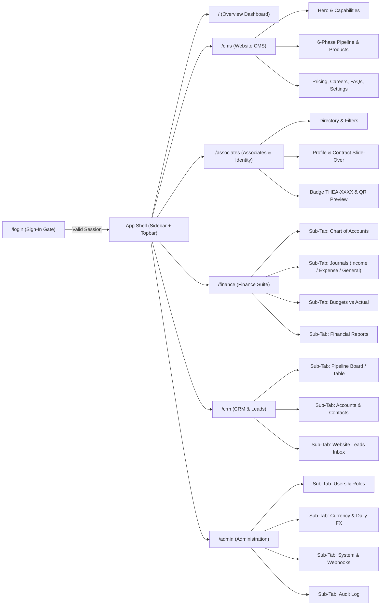

# Thea HQ (`hq.theasolutions.co`) — UI/UX & Design System Specification

- **Document Version**: `1.0.0`
- **Target Application**: Thea HQ — Internal Business Operating Portal (`hq.theasolutions.co`)
- **Brand Parent**: Thea Solutions (`theasolutions.co`)
- **Design Methodology**: Figma-First, Token-Driven Architecture (Material Design 3 elevation/state layers + shadcn/ui Radix primitives + TanStack Design System continuity)
- **Target Audience**: Internal Executives, Finance Operators, Content Administrators, Operations Managers, and Super Administrators
- **Handoff Target**: `frontend_engineer`

---

## 1. Executive Architecture & Information Hierarchy

Thea HQ consolidates five operational domains—Executive Overview, Dynamic Website CMS, Associates & Digital Identity, Double-Entry Finance Suite (MMK/THB dual currency), CRM & Lead Intake, and System Administration—inside a single dark-first desktop workspace that scales down cleanly to tablet and mobile viewports.

### 1.1 Navigation & Route Topology



### 1.2 Role-Based Visibility Rules

| Module / Route | Static Super Admin | Admin | Finance Manager | Ops / CMS Editor | Viewer |
| :--- | :--- | :--- | :--- | :--- | :--- |
| `/` Overview Dashboard | Full | Full | Full | Read (No Cash Detail) | Read Summary |
| `/cms` Website CMS | Publish + Edit | Publish + Edit | Read Only | Draft + Publish | Read Only |
| `/associates` Associates & Identity | Full + Revoke | Full + Revoke | Contract Rate Read | Profile Edit | Directory Read |
| `/finance` Finance Suite | Full + Lock Period | Full | Full | Denied | Read Reports |
| `/crm` CRM & Leads | Full | Full | Read Deals | Full | Read Only |
| `/admin` Administration | Full (Protected Root) | Users (Non-Root) + FX | FX Rate Only | Denied | Denied |

---

## 2. Design System & Token Architecture

Thea HQ extends the existing Thea Solutions palette defined in `AGENTS.md` and `webpage/tailwind.config.ts`. Dark theme is the default state on initial load, while Light theme is selectable via the topbar switch and persisted in `localStorage` under key `thea-hq-theme` (`"dark" | "light"`).

### 2.1 Semantic Color Tokens (Dark Default + Light Override)

All color pairings below meet WCAG 2.1 AA contrast requirements (`>= 4.5:1` for normal text, `>= 3.0:1` for large text and non-text UI boundaries).

| Token Variable | Dark Theme (Default) | Light Theme | Usage Semantics | Contrast Target |
| :--- | :--- | :--- | :--- | :--- |
| `--hq-canvas` | `#1A1816` | `#FAF9F7` | Global viewport background (`thea-carbon-black` / warm off-white) | Base layer |
| `--hq-surface` | `#181816` | `#FFFFFF` | Cards, panels, sidebar, topbar, modals (`thea-carbon-black-2`) | Elevation 1 |
| `--hq-surface-elevated` | `#22201D` | `#F3F0EC` | Card hover, table row hover, active menu backdrop, input fill | Elevation 2 |
| `--hq-surface-subtle` | `#1E1C1A` | `#F6F4F1` | Table headers, code/JSON preview wells, secondary panels | Inset surface |
| `--hq-border-subtle` | `rgba(241, 241, 240, 0.08)` | `#E7E2DC` | Hairline dividers, card borders, table row rules | Structural |
| `--hq-border-default` | `rgba(241, 241, 240, 0.16)` | `#D4CDC5` | Input outlines, secondary buttons, segmented track borders | `>= 3.0:1` UI |
| `--hq-border-accent` | `#5F1F2F` | `#5F1F2F` | Focused containers, active nav rail indicator (`thea-wine-plum`) | Brand anchor |
| `--hq-text-primary` | `#F1F1F0` | `#1A1816` | Headings, primary data values, primary labels (`thea-white-smoke`) | `> 14:1` |
| `--hq-text-secondary` | `#B8B3AE` | `#524B46` | Sub-labels, table metadata, helper captions | `> 7.2:1` |
| `--hq-text-muted` | `#8C857F` | `#6E6660` | Placeholders, disabled labels, inactive timestamps | `>= 4.6:1` |
| `--hq-brand-primary` | `#5F1F2F` | `#5F1F2F` | Primary wine-plum fill, active state badges (`thea-wine-plum`) | Brand core |
| `--hq-brand-hover` | `#8E2E46` | `#8E2E46` | Brand hover fill, gradient conduit (`thea-wine-plum-light`) | Brand hover |
| `--hq-brand-vibrant` | `#E36A88` | `#B82952` | Active stage beacon, focus ring, chart series (`berry-vibrant`) | `>= 4.5:1` |
| `--hq-brand-soft` | `#F3A6B7` | `#8E2E46` | Monospace eyebrow tags, badge ink on dark (`blush-pink`) | `>= 7.5:1` |
| `--hq-cta-bg` | `#F1F1F0` | `#5F1F2F` | High-emphasis primary action button fill | Primary CTA |
| `--hq-cta-text` | `#1A1816` | `#FFFFFF` | High-emphasis primary action button ink | `> 10:1` |
| `--hq-semantic-in` | `#10B981` | `#047857` | Money In, Under Budget, Verified, Balanced Ledger (Emerald) | `>= 4.8:1` |
| `--hq-semantic-in-bg` | `rgba(16, 185, 129, 0.14)` | `#DCFCE7` | Emerald status pill & chart positive tint | Surface tint |
| `--hq-semantic-warn` | `#F59E0B` | `#B45309` | Warning, Expiring Card, Draft, Pending Sync (Amber) | `>= 4.6:1` |
| `--hq-semantic-warn-bg` | `rgba(245, 158, 11, 0.14)` | `#FEF3C7` | Amber status pill & utilization warning tint | Surface tint |
| `--hq-semantic-out` | `#F43F5E` | `#BE123C` | Money Out, Over Budget, Revoked, Error, Unbalanced (Rose) | `>= 4.8:1` |
| `--hq-semantic-out-bg` | `rgba(244, 63, 94, 0.14)` | `#FFE4E6` | Rose status pill, destructive action tint | Surface tint |
| `--hq-focus-ring` | `#E36A88` | `#5F1F2F` | Keyboard `:focus-visible` 2px outline with 2px offset | `>= 4.5:1` |

### 2.2 Typography Scale & Tabular Numeric Rules

Font families inherit Next.js `next/font/google` CSS variables configured in `layout.tsx`:
- **Display**: `Bricolage Grotesque` (`--font-ds-display`)
- **Body / UI**: `Inter` (`--font-sans`)
- **Monospace / Financial**: `IBM Plex Mono` (`--font-ds-mono`)

| Role | Family | Size / Line-Height | Weight | Tracking | Required CSS Modifiers |
| :--- | :--- | :--- | :--- | :--- | :--- |
| Page Title (`h1`) | Bricolage Grotesque | `28px / 34px` (`1.75rem`) | `600` | `-0.02em` | Strict single `<h1>` per route |
| Section Heading (`h2`) | Bricolage Grotesque | `20px / 28px` (`1.25rem`) | `600` | `-0.015em` | Panel titles, modal titles |
| Card Title (`h3`) | Bricolage Grotesque | `16px / 24px` (`1rem`) | `600` | `-0.01em` | KPI headers, sub-panels |
| Body Default | Inter | `14px / 20px` (`0.875rem`) | `400` | `0` | Form labels, table descriptions |
| Body Compact | Inter | `13px / 18px` (`0.8125rem`) | `400/500` | `0` | Dense tables, filter chips |
| Micro Label / Eyebrow | IBM Plex Mono | `11px / 16px` (`0.6875rem`) | `500` | `0.06em` | `text-transform: uppercase` |
| KPI Hero Figure | IBM Plex Mono | `26px / 32px` (`1.625rem`) | `600` | `-0.02em` | `font-variant-numeric: tabular-nums` |
| Ledger / Amount Cell | IBM Plex Mono | `13px / 20px` (`0.8125rem`) | `500` | `0` | `tabular-nums; text-align: right` |
| Code / ID / FX Token | IBM Plex Mono | `12px / 18px` (`0.75rem`) | `500` | `0.02em` | `THEA-XXXX`, COA `1100`, `JRN-2026-0041`, `1 THB = 128.50 MMK` |

**Mandatory Monospace Enforcement**: Every MMK/THB currency amount, FX conversion rate, Chart of Accounts code (`1000`–`6999`), journal reference (`JRN-YYYY-NNNN`), associate credential identifier (`THEA-XXXX`), and variance percentage MUST use `font-ds-mono` with `tabular-nums` so vertical columns align pixel-for-pixel across ledger and report tables.

### 2.3 Spacing Grid, Radii, Elevation & Z-Index Scale

- **Base Grid**: Strict `4px` micro-unit / `8px` structural rhythm (`4, 8, 12, 16, 20, 24, 32, 40, 48px`).
- **Border Radii**:
  - Inputs, table action buttons, badges: `6px` (`rounded-md`)
  - Cards, panels, modals, dropdowns: `12px` (`rounded-xl`)
  - Primary pill buttons, status chips, segmented switches: `9999px` (`rounded-full`)
- **Elevation Tokens**:
  - `Level 0` (Canvas): Flat `#1A1816` / `#FAF9F7`
  - `Level 1` (Card / Shell): `1px solid var(--hq-border-subtle)`, Light shadow `0 1px 3px rgba(26,24,22,0.06)`, Dark shadow `0 2px 10px rgba(0,0,0,0.35)`
  - `Level 2` (Dropdown / Popover): `1px solid var(--hq-border-default)`, Light shadow `0 10px 28px rgba(26,24,22,0.10)`, Dark shadow `0 12px 32px rgba(0,0,0,0.55)`
  - `Level 3` (Modal / Slide-Over): Backdrop `rgba(12, 11, 10, 0.72)` with `backdrop-filter: blur(8px)`, border `1px solid rgba(95, 31, 47, 0.45)`
- **Z-Index Layers**:
  - `z-10`: Sticky table headers & sticky CMS publish footer
  - `z-20`: Fixed desktop sidebar & topbar
  - `z-30`: Mobile sidebar backdrop & drawer
  - `z-40`: Slide-over drawers (Associate Editor, JSON Preview, Audit Diff)
  - `z-50`: Modal dialogs (Journal Entry, Revoke Confirmation, Convert to Deal)
  - `z-60`: Toast notifications & skip-to-content link

### 2.4 Figma Library & Code Connect Mapping

| Figma Page / Frame | Figma Variable Collection | Radix / shadcn Primitive | Target Component Path |
| :--- | :--- | :--- | :--- |
| `00_Tokens / Colors & Typography` | `Theme [Dark, Light]` | CSS Variables in `globals.css` | `src/styles/tokens.css` |
| `01_Shell / Sidebar + Topbar` | `Viewport [375, 768, 1280, 1440]` | `Sheet`, `DropdownMenu`, `Tooltip` | `src/components/shell/AppShell.tsx` |
| `02_Auth / Sign-In` | `Theme [Dark, Light]` | `Card`, `Input`, `Button`, `Alert` | `src/app/login/page.tsx` |
| `03_Dashboard / Executive KPI` | `Currency [MMK, THB]` | `Card`, `Tabs`, `Progress`, `Badge` | `src/app/(portal)/page.tsx` |
| `04_CMS / Split Editor` | `State [Clean, Dirty, Draft]` | `Tabs`, `Accordion`, `Sheet`, `Switch` | `src/app/(portal)/cms/page.tsx` |
| `05_Associates / Directory & Badge` | `Status [Active, Expiring, Revoked]` | `Table`, `Sheet`, `Dialog`, `Badge` | `src/app/(portal)/associates/page.tsx` |
| `06_Finance / COA, Journals, Budget, Reports` | `Currency [MMK, THB]` | `Tabs`, `Dialog`, `Table`, `Select` | `src/app/(portal)/finance/page.tsx` |
| `07_CRM / Board, Accounts, Leads` | `View [Kanban, Table]` | `Tabs`, `Card`, `Dialog`, `DropdownMenu` | `src/app/(portal)/crm/page.tsx` |
| `08_Admin / RBAC, FX, Webhooks, Audit` | `Role [SuperAdmin, Admin]` | `Tabs`, `Table`, `Dialog`, `Sheet` | `src/app/(portal)/admin/page.tsx` |

---

## 3. Responsive Breakpoints & Autolayout Rules

Global document safety enforces `overflow-x: hidden; max-width: 100vw; width: 100%;` on `html`, `body`, and `<main>`. Financial tables and Kanban boards render inside dedicated horizontal scroll wrappers (`overflow-x-auto`) with sticky leading columns so narrow screens never produce page-level horizontal overflow.

| Breakpoint | Width Range | Sidebar Behavior | Content Container Padding | Grid Columns (KPI / Content) | Touch Target Minimum |
| :--- | :--- | :--- | :--- | :--- | :--- |
| **Mobile** | `375px – 767px` | Off-canvas slide-over drawer (`280px` width) triggered by topbar hamburger | `16px` (`px-4 py-4`) | `1 col` stacked; tables scroll internally | `48px x 48px` |
| **Tablet** | `768px – 1279px` | Collapsed `72px` icon rail with hover/focus tooltips + expandable drawer toggle | `20px` (`px-5 py-5`) | `2 col` KPI strip; `1 col` complex splits | `44px x 44px` |
| **Desktop** | `1280px – 1439px` | Persistent `240px` expanded sidebar (collapsible to `72px` rail) | `24px` (`px-6 py-6`) | `4 col` KPI strip; `12 col` analytical grid | `36px – 40px` height |
| **Wide** | `1440px – 1920px+` | Persistent `256px` expanded sidebar; inner content `max-w-[1600px] mx-auto` | `32px` (`px-8 py-6`) | `4 col` KPI strip; `12 col` with expanded drawers | `36px – 40px` height |

**Autolayout Rules**:
- Sidebar flex direction: `flex-col justify-between h-screen sticky top-0 shrink-0`.
- Topbar flex direction: `flex items-center justify-between gap-3 h-16 px-4 lg:px-6 sticky top-0`.
- Toolbar action clusters: `flex flex-wrap items-center gap-2` so filter pills wrap gracefully at `768px` without clipping.
- Card internals: `flex flex-col gap-4 p-5` with `min-w-0` on every flex/grid child to guarantee monospace truncation (`truncate`) works inside nested containers.

---

## 4. View Wireframes & Interaction Specifications

### 4.1 View 1: Sign-In Screen (`/login`)

**Purpose**: Minimal, internal-only authentication gate for authorized Thea Solutions personnel. Contains zero self-registration link, zero social OAuth clutter, and zero public marketing copy.

#### Desktop Wireframe (`1280px+`)

```text
+----------------------------------------------------------------------------------+
| [THEA SOLUTIONS]                                            [Theme: Dark | Light]|
|                                                                                  |
|                                                                                  |
|                       +----------------------------------+                       |
|                       |            [THEA CREST]          |                       |
|                       |             THEA HQ              |                       |
|                       |   INTERNAL OPERATING PORTAL      |                       |
|                       | -------------------------------- |                       |
|                       |                                  |                       |
|                       |  Work Email                      |                       |
|                       |  +----------------------------+  |                       |
|                       |  | name@theasolutions.co      |  |                       |
|                       |  +----------------------------+  |                       |
|                       |                                  |                       |
|                       |  Password                        |                       |
|                       |  +----------------------------+  |                       |
|                       |  | ******************  [Show] |  |                       |
|                       |  +----------------------------+  |                       |
|                       |  [!] Invalid email or password.  |  <-- Inline error     |
|                       |                                  |      slot (reserved)  |
|                       |  +----------------------------+  |                       |
|                       |  |          Sign In           |  |                       |
|                       |  +----------------------------+  |                       |
|                       |                                  |                       |
|                       |  Authorized personnel only.      |                       |
|                       |  Contact Super Admin for access. |                       |
|                       +----------------------------------+                       |
|                                                                                  |
|                                                                                  |
|                hq.theasolutions.co  |  UTC+6:30  |  Protected Access             |
+----------------------------------------------------------------------------------+
```

#### Mobile Adaptation (`375px`)
- Card spans `100%` width minus `16px` horizontal padding (`max-w-[420px]`), vertically centered with `min-h-[100dvh]`.
- Inputs and Sign In CTA expand to `48px` height (`min-h-12`) with `16px` font size to prevent iOS viewport zoom.

#### Functional & Security Rules
- **Fields**: Email (`type="email"`, `autocomplete="username"`) and Password (`type="password"`, `autocomplete="current-password"`, visibility toggle button with `aria-pressed` and `aria-label`).
- **Zero Register Flow**: No "Create Account", "Sign Up", or self-serve password reset link. Static footer note directs locked users to the Super Admin.
- **Validation**: Client-side format validation on blur/submit; server auth errors render in a role=`alert` inline Rose banner (`--hq-semantic-out-bg`) without clearing the email field.
- **Ambient Brand Accent**: Subtle radial wine-plum glow (`rgba(95, 31, 47, 0.22)`) behind the card in dark mode; crisp `#FFFFFF` card with `#E7E2DC` border in light mode.

---

### 4.2 View 2: Global App Shell

**Purpose**: Persistent navigation frame wrapping all authenticated routes (`/`, `/cms`, `/associates`, `/finance`, `/crm`, `/admin`). Houses global display currency, live daily FX rate visibility, theme toggle, user identity, and sign-out.

#### Desktop Wireframe (`1280px – 1920px`)

```text
+-----------------------+------------------------------------------------------------------+
| [CREST] THEA HQ  [<<] | [Route Breadcrumb: Overview / Finance]                           |
| HQ.THEASOLUTIONS.CO   |       [MMK | THB]  [1 THB = 128.50 MMK]  [Theme]  [User v]  [Out]|
+-----------------------+------------------------------------------------------------------+
|                       |                                                                  |
|  WORKSPACE            |  <main id="main-content" tabindex="-1">                          |
|  > Overview           |                                                                  |
|    Website CMS        |    +----------------------------------------------------------+  |
|    Associates         |    |                                                          |  |
|                       |    |                 ACTIVE VIEW CONTENT                      |  |
|  OPERATIONS           |    |            (Max Width 1600px on 1920px Wide)             |  |
|    Finance Suite      |    |                                                          |  |
|    CRM & Leads        |    |                                                          |  |
|                       |    |                                                          |  |
|  GOVERNANCE           |    +----------------------------------------------------------+  |
|    Administration     |                                                                  |
|                       |                                                                  |
| ----------------------|                                                                  |
| [Avatar] Thuta Tun    |                                                                  |
| [CROWN] SUPER ADMIN   |                                                                  |
+-----------------------+------------------------------------------------------------------+
```

#### Mobile Wireframe (`375px`)

```text
+-----------------------------------+
| [=] THEA HQ    [MMK|THB] [T] [U]  |  <-- Sticky 56px mobile header
+-----------------------------------+
| [FX: 1 THB = 128.50 MMK | Today]  |  <-- Compact 32px sub-strip (tappable -> FX modal)
+-----------------------------------+
|                                   |
|       ACTIVE VIEW CONTENT         |
|       (16px horizontal pad)       |
|                                   |
+-----------------------------------+
```

#### Topbar Control Specifications
1. **Global Currency Display Toggle (`MMK | THB`)**:
   - Segmented radio group (`role="radiogroup"`, `aria-label="Display Currency"`).
   - Active segment fills with `--hq-brand-primary` (`#5F1F2F`) and `#F1F1F0` monospace text.
   - Switching immediately recalculates all displayed dashboards, charts, KPI cards, and report views using the active daily FX rate while preserving underlying transaction native currency on hover tooltips.
2. **Live FX Rate Badge (`1 THB = 128.50 MMK`)**:
   - Monospace pill (`IBM Plex Mono`, `tabular-nums`) displaying current active rate and staleness indicator dot: Emerald (updated today), Amber (older than 24h), Rose (missing rate).
   - Clicking navigates to `/admin?tab=fx` (for Admin/Finance roles) or opens a read-only 7-day FX history popover.
3. **Light / Dark Theme Switch**:
   - Icon toggle (`40px` desktop / `48px` mobile) switching `document.documentElement.dataset.theme` and persisting to `localStorage.setItem('thea-hq-theme', value)`.
4. **User Profile & Super Admin Indicator**:
   - Displays initials avatar, full name, and role badge. Static Super Admin renders a dedicated wine-plum/blush badge with `[CROWN]` vector glyph (`SUPER ADMIN`).
5. **Sign-Out Button**:
   - Dedicated icon+label action inside topbar or user menu (`aria-label="Sign out of Thea HQ"`), clearing session cookie and redirecting to `/login`.

---

### 4.3 View 3: Overview Dashboard (`/`)

**Purpose**: Executive real-time operational pulse combining treasury cashflow, COA spending distribution, budget burn, credential expirations, and inbound sales pipeline leads.

#### Desktop Wireframe (`1280px+`)

```text
+----------------------------------------------------------------------------------------+
| Overview Dashboard                                        [Period: Nov 2026 v] [+ Entry]|
| Financial telemetry displayed in MMK (1 THB = 128.50 MMK)                               |
+----------------------------------------------------------------------------------------+
| +-------------------+ +-------------------+ +-------------------+ +-------------------+ |
| | CASH POSITION     | | MTD MONEY IN      | | MTD MONEY OUT     | | NET MARGIN (MTD)  | |
| | 184,520,000 MMK   | |  42,800,000 MMK   | |  27,150,000 MMK   | |       36.57%      | |
| | +8.4% vs last mo  | | [IN] 14 receipts  | | [OUT] 39 payouts  | | +15,650,000 MMK   | |
| +-------------------+ +-------------------+ +-------------------+ +-------------------+ |
|                                                                                         |
| +--------------------------------------------------+ +--------------------------------+ |
| | MONEY IN VS MONEY OUT (6M / 12M)    [6M] [12M]   | | MONEY USAGES BY COA CATEGORY   | |
| |  50M |      [I]           [I]           [I]      | | 6100 Engineering  44%  11.9M   | |
| |  35M |  [I] [O]   [I]     [O]   [I]     [O]      | | [|||||||||||||..............]  | |
| |  20M |  [O] [O]   [O] [I] [O]   [O] [I] [O]      | | 6200 Cloud Infra  22%   6.0M   | |
| |  10M |  [O] [O]   [O] [O] [O]   [O] [O] [O]      | | [|||||||....................]  | |
| |   0  +-----------------------------------------  | | 6300 Operations   18%   4.9M   | |
| |        Jun   Jul   Aug   Sep   Oct   Nov         | | [|||||......................]  | |
| |  Legend: [Emerald] Money In   [Rose] Money Out   | | 6400 Marketing    16%   4.3M   | |
| +--------------------------------------------------+ +--------------------------------+ |
|                                                                                         |
| +--------------------------------------------------+ +--------------------------------+ |
| | BUDGET VS ACTUAL UTILIZATION (NOV 2026)  [All ->]| | ACTION QUEUE                   | |
| |                                                  | | [Tab: Expiring Cards (3)]      | |
| | 6100 Engineering Pods    11.9M / 15.0M   79.3%   | | [Tab: Website Leads (5)]       | |
| | [||||||||||||||||||||||......]  [Under Budget]   | | ------------------------------ | |
| |                                                  | | THEA-0104  Aung Ko  [Exp: 6d]  | |
| | 6200 Cloud & AI APIs      6.0M /  6.5M   92.3%   | | Advisor Contract   [Renew ->]  | |
| | [||||||||||||||||||||||||||..]  [Near Limit]     | | ------------------------------ | |
| |                                                  | | THEA-0112  May Thu  [Exp: 14d] | |
| | 6400 Growth & Events      4.3M /  4.0M  107.5%   | | Freelancer         [Renew ->]  | |
| | [||||||||||||||||||||||||||||]  [Over Budget]    | | ------------------------------ | |
| +--------------------------------------------------+ +--------------------------------+ |
+----------------------------------------------------------------------------------------+
```

#### Layout & Data Visualization Specifications
- **KPI Strip**: 4 equal cards (`grid-cols-1 sm:grid-cols-2 xl:grid-cols-4 gap-4`).
  - Cash Position: Neutral primary ink + Emerald/Rose delta chip.
  - MTD Money In: Top `2px` Emerald accent strip (`#10B981`), value in `IBM Plex Mono`.
  - MTD Money Out: Top `2px` Rose accent strip (`#F43F5E`), value in `IBM Plex Mono`.
  - Net Margin: Percentage in `IBM Plex Mono` (`#10B981` when positive, `#F43F5E` when negative) plus absolute net profit subtitle.
- **Money In vs Out Chart**: `col-span-12 xl:col-span-8`. Dual-series grouped bars (`#10B981` Money In, `#F43F5E` Money Out) with accessible hover/focus tooltip showing exact MMK and THB equivalents.
- **Money Usages by COA Category**: `col-span-12 xl:col-span-4`. Horizontal progress bars ranked descending by spend, showing COA code, category name, share percentage, and monetary amount.
- **Budget vs Actual Utilization**: `col-span-12 xl:col-span-7`. Color-coded bars: Emerald (`< 85%`), Amber (`85% – 100%`), Rose (`> 100%`, clamped visually at `100%` with explicit `+X.X% OVER` badge).
- **Action Queue (Expiring Cards & Recent Website Leads)**: `col-span-12 xl:col-span-5`. Tabbed card switching between `Expiring Associate Cards` (<= 30 days to expiry, deep-linking to `/associates?edit=THEA-XXXX`) and `Recent Website Leads` (last 5 submissions from `/api/contact`, `/api/demo-request`, `/api/quote` with quick jump to `/crm?tab=leads`).

---

### 4.4 View 4: Dynamic Website CMS (`/cms`)

**Purpose**: Structured visual content manager controlling all live sections on `theasolutions.co` without manual code edits. Supports schema-validated forms, draft saving, live JSON/preview inspection, and atomic publish with revalidation.

#### Desktop Wireframe (`1280px+`)

```text
+----------------------------------------------------------------------------------------+
| Dynamic Website CMS                             [Live Site: Synced]  [JSON / Preview]  |
+----------------------+-----------------------------------------------------------------+
| SECTIONS             | SECTION EDITOR: 6-Phase Pipeline (Section 3)                    |
|                      | Status: [Draft Modified]   Last Published: 2026-11-24 14:20     |
|   Hero               | --------------------------------------------------------------- |
|   Capabilities       | Eyebrow Label                                                   |
| > 6-Phase Pipeline   | +-------------------------------------------------------------+ |
|   Products           | | DELIVERY METHODOLOGY                                        | |
|   Pricing            | +-------------------------------------------------------------+ |
|   Careers            | Section Headline                                                |
|   FAQs               | +-------------------------------------------------------------+ |
|   Site Settings      | | Predictable 2-Week Agile Delivery Cycles                    | |
|                      | +-------------------------------------------------------------+ |
|                      |                                                                 |
|                      | Phases (6 items — drag handle or up/down arrows to reorder)     |
|                      | +-------------------------------------------------------------+ |
|                      | | [=] Phase 01: Discovery & Architecture     [Days 1-7]  [v]  | |
|                      | |     Focus: System blueprint & milestone lock                | |
|                      | |     Deliverables: [PRD] [UI/UX Spec] [Cloud Spec] [+ Add]   | |
|                      | +-------------------------------------------------------------+ |
|                      | | [=] Phase 02: Core Foundation Sprint       [Week 2]    [>]  | |
|                      | +-------------------------------------------------------------+ |
|                      | | [=] Phase 03: Integration & Automation     [Weeks 3-4] [>]  | |
|                      | +-------------------------------------------------------------+ |
|                      |                                                 [+ Add Phase]   |
+----------------------+-----------------------------------------------------------------+
| [!] Unsaved changes in 6-Phase Pipeline         [Discard]  [Save Draft]  [Publish Live]|
+----------------------------------------------------------------------------------------+
```

#### Slide-Over Drawer: Live JSON & Component Preview (`480px – 560px`)

```text
+----------------------------------------------+
| Preview & Payload                       [ X ]|
| [ Visual Preview ]   [ Structured JSON ]     |
+----------------------------------------------+
| {                                            |
|   "section": "pipeline",                     |
|   "version": 14,                             |
|   "status": "draft",                         |
|   "phases": [                                |
|     { "index": "01", "window": "Days 1-7" }  |
|   ]                                          |
| }                                            |
+----------------------------------------------+
| [Copy JSON]           [Validate Schema: OK]  |
+----------------------------------------------+
```

#### Responsive & Interaction Details
- **8 Left Sections**: `Hero`, `Capabilities`, `6-Phase Pipeline`, `Products`, `Pricing`, `Careers`, `FAQs`, `Site Settings`.
- **Mobile (`375px`) & Tablet (`768px`)**: Left section list collapses into a sticky horizontal scrollable dropdown/tab selector above the editor form.
- **Sticky Draft/Publish Bar**: Fixed to the bottom of the CMS viewport (`z-10`) whenever `isDirty === true` or a saved draft differs from published state. Displays Amber `Draft Unsaved` / `Draft Saved` status pill, `Discard`, `Save Draft`, and high-contrast `Publish Live` button (triggers confirmation dialog summarizing modified sections before webhook revalidation).

---

### 4.5 View 5: Associates & Digital Identity (`/associates`)

**Purpose**: Central registry for contractors, freelancers, advisors, and executives, managing contract rates (MMK/THB), public Digital Business Cards (`theasolutions.co/{slug}`), and tamper-proof Verification Badges (`theasolutions.co/verify/THEA-XXXX`).

#### Desktop Wireframe (`1280px+`)

```text
+----------------------------------------------------------------------------------------+
| Associates & Digital Identity                                       [+ Add Associate]  |
+----------------------------------------------------------------------------------------+
| [Search name, role, THEA-XXXX...]                                                      |
| Type:   [All] [Contractor] [Freelancer] [Advisor] [Executive]                          |
| Status: [All] [Active] [Expiring Soon] [Expired] [Revoked]          Showing 18 records |
+----------------------------------------------------------------------------------------+
| ID         | Associate          | Type       | Contract Rate     | Expiry     | Status |
|------------+--------------------+------------+-------------------+------------+--------|
| THEA-0101  | Dr. Ohnmar Than    | Executive  |  4,500,000 MMK/mo | 2027-12-31 | [VERIF]|
| THEA-0104  | Aung Ko Min        | Advisor    |     45,000 THB/mo | 2026-12-01 | [EXPIR]|
| THEA-0108  | Thiri Chan Nyein   | Contractor |  2,800,000 MMK/mo | 2027-06-30 | [VERIF]|
| THEA-0115  | Kyaw Zin Htet      | Freelancer |     18,000 THB/pr | 2026-10-15 | [REVOK]|
+----------------------------------------------------------------------------------------+
```

#### Slide-Over Editor & Verification Identity Panel (`560px` desktop / `100vw` mobile)

```text
+----------------------------------------------------------+
| Edit Associate: THEA-0104                          [ X ] |
| [ Profile ]  [ Contract & Rate ]  [ Digital ID & Badge ] |
+----------------------------------------------------------+
|  VERIFICATION BADGE PREVIEW                              |
|  +----------------------------------------------------+  |
|  | [THEA CREST]       VERIFIED ASSOCIATE    [Active]  |  |
|  |                                                    |  |
|  |  [Avatar]  Aung Ko Min                 +--------+  |  |
|  |            Principal AI Advisor        | [ QR ] |  |  |
|  |            ID: THEA-0104               |  CODE  |  |  |
|  |            Valid: 2026-12-01           +--------+  |  |
|  +----------------------------------------------------+  |
|                                                          |
|  Verification URL                                        |
|  +-------------------------------------+ +------------+  |
|  | https://theasolutions.co/verify/... | | Copy URL   |  |
|  +-------------------------------------+ +------------+  |
|                                                          |
|  Digital Business Card Link (UTM Tagged)                 |
|  +-------------------------------------+ +------------+  |
|  | https://theasolutions.co/aung-ko... | | Open Card  |  |
|  +-------------------------------------+ +------------+  |
|                                                          |
|  Contract Compensation                                   |
|  Amount: [ 45,000.00      ]  Currency: [ THB v ]         |
|  Equivalent: 5,782,500 MMK @ 1 THB = 128.50 MMK          |
|                                                          |
|  DANGER ZONE                                             |
|  +----------------------------------------------------+  |
|  | Revoking immediately invalidates public badge & QR |  |
|  |                                [ Revoke Badge ]    |  |
|  +----------------------------------------------------+  |
+----------------------------------------------------------+
| [Cancel]                                  [Save Changes] |
+----------------------------------------------------------+
```

#### Status Token Mapping & Revocation Safeguard
- `Verified / Active`: Emerald pill (`--hq-semantic-in`).
- `Expiring Soon` (`<= 30 days`): Amber pill (`--hq-semantic-warn`).
- `Expired` / `Revoked`: Rose pill (`--hq-semantic-out`).
- **One-Click Revoke Flow**: Clicking `Revoke Badge` triggers an immediate inline confirmation dialog requiring a mandatory revocation reason (`Contract Ended`, `Security Incident`, `Role Transition`, `Other`). Confirmation logs an immutable entry in `/admin?tab=audit` and flips the public verification endpoint immediately.

---

### 4.6 View 6: Finance Suite (`/finance`)

**Purpose**: Complete dual-currency (`MMK` / `THB`) accounting ledger built around a structured Chart of Accounts (`1000`–`6000`), double-entry journal workflows, departmental budget tracking, and executive financial statements.

#### Shared Finance Sub-Tab Header

```text
+----------------------------------------------------------------------------------------+
| Finance Suite                              [+ Quick Income] [+ Quick Expense] [+ JRN]  |
| [ Chart of Accounts ]  [ Journals ]  [ Budgets vs. Actual ]  [ Reports ]               |
+----------------------------------------------------------------------------------------+
```

---

#### 4.6.1 Sub-Tab A: Chart of Accounts (`/finance?tab=coa`)

```text
+----------------------------------------------------------------------------------------+
| [Search code or account name...]  [Class: All v]  [Expand All / Collapse] [+ Account]  |
+----------------------------------------------------------------------------------------+
| Code  | Account Name                       | Type      | Currency | Running Balance    |
|-------+------------------------------------+-----------+----------+--------------------|
| v 1000| ASSETS                             | Group     | Multi    | 184,520,000 MMK    |
|   1100|   Cash & Bank — KBZ MMK            | Asset     | MMK      | 112,400,000 MMK    |
|   1110|   Cash & Bank — Kasikorn THB       | Asset     | THB      |  72,120,000 MMK*   |
|   1200|   Accounts Receivable              | Asset     | Multi    |  18,500,000 MMK    |
| v 2000| LIABILITIES                        | Group     | Multi    |  14,200,000 MMK    |
|   2100|   Accounts Payable                 | Liability | Multi    |   9,800,000 MMK    |
| > 3000| EQUITY                             | Group     | Multi    | 154,670,000 MMK    |
| > 4000| REVENUE                            | Group     | Multi    |  42,800,000 MMK    |
| > 5000| DIRECT COSTS (COGS)                | Group     | Multi    |  12,400,000 MMK    |
| v 6000| OPERATING EXPENSES                 | Group     | Multi    |  14,750,000 MMK    |
|   6100|   Engineering & Associate Pods     | Expense   | Multi    |  11,900,000 MMK    |
|   6200|   Cloud Infrastructure & AI APIs   | Expense   | THB      |   6,000,000 MMK*   |
+----------------------------------------------------------------------------------------+
* Asterisk indicator tooltip reveals native THB balance & applied FX rate.
```

- **Add / Edit Account Modal**: Fields for Parent Group (`1000`–`6000`), Numeric Account Code (4 digits, monospace, unique validation), Account Name, Normal Balance (`Debit` / `Credit`, auto-inferred from parent), Default Currency (`MMK`, `THB`, `Multi`), Active Toggle, and Description. System root groups (`1000`–`6000`) cannot be deleted.

---

#### 4.6.2 Sub-Tab B: Journals — Income / Expense / General (`/finance?tab=journals`)

```text
+----------------------------------------------------------------------------------------+
| Filter: [ All ] [ Income ] [ Expense ] [ General ]   [Date: Nov 2026 v]  [Search...]   |
+----------------------------------------------------------------------------------------+
| Journal #     | Date       | Type    | Memo / Counterparty   | Native Amt  | Display   |
|---------------+------------+---------+-----------------------+-------------+-----------|
| JRN-2026-0142 | 2026-11-24 | [IN]    | Acme Retainer Inv #18 |  95,000 THB | 12.21M MMK|
| JRN-2026-0141 | 2026-11-23 | [OUT]   | AWS & OpenAI Usage    |  14,200 THB |  1.82M MMK|
| JRN-2026-0140 | 2026-11-22 | [GEN]   | FX Revaluation Adj    |       --    |  0.45M MMK|
+----------------------------------------------------------------------------------------+
```

**Quick Income / Expense Modal (`520px`)**:
- Single-page rapid entry automatically generating the balanced double-entry journal lines under the hood (e.g., Debit Bank `1100` / Credit Revenue `4100` for Income).
- Includes Amount, Currency (`MMK` / `THB`), auto-populated Daily FX Rate (editable with audit override note), Counterparty, Cash/Bank Account, COA Category, Date, Reference/Receipt URL, and Memo.

**Balanced Multi-Line General Journal Modal (`780px` desktop / fullscreen sheet mobile)**:

```text
+----------------------------------------------------------------------------------+
| New General Journal Entry (JRN-2026-0143)                                  [ X ] |
+----------------------------------------------------------------------------------+
| Date: [2026-11-25]   Currency: [ THB v ]   Daily FX Rate: [ 128.50 ] MMK/THB     |
| Memo: [ Monthly associate payout allocation and bank transfer                ]   |
+----------------------------------------------------------------------------------+
| Account (COA)              | Line Memo          | Debit (THB)    | Credit (THB)  |
|----------------------------+--------------------+----------------+---------------|
| [6100 Engineering Pods v]  | Nov Sprint Pod     |   45,000.00    |         0.00  |
| [6200 Cloud Infra      v]  | Staging Cluster    |    5,000.00    |         0.00  |
| [1110 Kasikorn THB     v]  | Wire Settlement    |        0.00    |    50,000.00  |
| [+ Add Journal Line]                                                             |
+----------------------------------------------------------------------------------+
| BALANCE METER:  Debits: 50,000.00 THB  |  Credits: 50,000.00 THB                 |
| [OK] BALANCED (Diff: 0.00 THB  /  Display Equiv: 6,425,000 MMK)                  |
+----------------------------------------------------------------------------------+
| [Cancel]                                           [Save Draft]  [Post Journal]  |
+----------------------------------------------------------------------------------+
```

- **Live Balance Meter Rules**:
  - When `totalDebit === totalCredit && totalDebit > 0`: Emerald indicator (`#10B981`), `Post Journal` enabled.
  - When `totalDebit !== totalCredit`: Rose indicator (`#F43F5E`) showing exact out-of-balance delta (`Diff: +5,000.00 THB`), `Post Journal` button strictly disabled with `aria-disabled="true"` and descriptive helper message.
  - Auto-populated FX rate pulls the latest active rate for the selected journal date from `/admin?tab=fx`.

---

#### 4.6.3 Sub-Tab C: Budgets vs. Actual (`/finance?tab=budgets`)

```text
+----------------------------------------------------------------------------------------+
| Period: [ Monthly | Quarterly ]   [ Nov 2026 v ]   Total Utilized: 78.4% (27.15M/34.6M)|
+----------------------------------------------------------------------------------------+
| COA  | Category            | Budget (Click Edit) | Actual        | Variance   | Burn   |
|------+---------------------+---------------------+---------------+------------+--------|
| 6100 | Engineering Pods    |  [ 15,000,000 MMK ] | 11,900,000    | +3,100,000 |  79.3% |
|      |                     |  [||||||||||||||||||||||......]                  | [OK]   |
| 6200 | Cloud & AI APIs     |  [  6,500,000 MMK ] |  6,000,000    |   +500,000 |  92.3% |
|      |                     |  [||||||||||||||||||||||||||..]                  | [WARN] |
| 6400 | Growth & Events     |  [  4,000,000 MMK ] |  4,300,000    |   -300,000 | 107.5% |
|      |                     |  [||||||||||||||||||||||||||||]                  | [OVER] |
+----------------------------------------------------------------------------------------+
```

- **Inline Budget Editing**: Clicking any Budget cell converts it into a focused monospace numeric input (`Enter` commits with optimistic update + toast; `Escape` cancels).

---

#### 4.6.4 Sub-Tab D: Financial Reports (`/finance?tab=reports`)

```text
+----------------------------------------------------------------------------------------+
| Report Type: [ Money In/Out ] [ P&L Statement ] [ Trial Balance ] [ Money Usages ]     |
| Range: [ This Month v ]  [2026-11-01 -> 2026-11-30]     [Export CSV]  [Print / PDF]    |
+----------------------------------------------------------------------------------------+
| PROFIT & LOSS STATEMENT — NOVEMBER 2026 (Display: MMK @ 1 THB = 128.50 MMK)            |
|----------------------------------------------------------------------------------------|
| 4000 REVENUE                                                                           |
|   4100 Bespoke Engineering Retainers                                   34,200,000 MMK  |
|   4200 AI Automation & Advisory                                         8,600,000 MMK  |
| TOTAL REVENUE                                                          42,800,000 MMK  |
|----------------------------------------------------------------------------------------|
| 5000 DIRECT COSTS (COGS)                                              (12,400,000 MMK) |
| GROSS PROFIT (71.03%)                                                  30,400,000 MMK  |
|----------------------------------------------------------------------------------------|
| 6000 OPERATING EXPENSES                                               (14,750,000 MMK) |
|----------------------------------------------------------------------------------------|
| NET OPERATING INCOME (36.57%)                                          15,650,000 MMK  |
+----------------------------------------------------------------------------------------+
```

- **Trial Balance Safeguard**: Displays `Debit` and `Credit` columns side-by-side with a pinned verification footer confirming `Total Debits === Total Credits` (Emerald badge) or flagging ledger discrepancy (Rose alert).

---

### 4.7 View 7: CRM (`/crm`)

**Purpose**: Tracks B2B opportunities from inbound website inquiry through signed retainer, unifying deal stages, client accounts, and live website form submissions.

#### Desktop Wireframe (`1280px+`)

```text
+----------------------------------------------------------------------------------------+
| CRM & Revenue Pipeline                                                     [+ New Deal]|
| [ Pipeline ]  [ Accounts & Contacts ]  [ Website Leads Inbox (5) ]                     |
+----------------------------------------------------------------------------------------+
| View: [ Board | Table ]   [Owner: All v]   Pipeline Value: 142,000,000 MMK (Weighted)  |
+-------------------+-------------------+-------------------+----------------------------+
| QUALIFIED (3)     | PROPOSAL (2)      | NEGOTIATION (2)   | WON / CLOSED (4)           |
| 38,500,000 MMK    | 54,000,000 MMK    | 49,500,000 MMK    | 88,200,000 MMK             |
|-------------------+-------------------+-------------------+----------------------------|
| +---------------+ | +---------------+ | +---------------+ | +------------------------+ |
| | Apex Logistics| | | Siam FinTech  | | | Yangon Retail | | | Mekong Health ERP      | |
| | AI Dispatch   | | | Cloud Audit   | | | POS AI Sync   | | | Phase 1 Retainer       | |
| | 18,000,000 MMK| | | 240,000 THB   | | | 32,000,000 MMK| | | 350,000 THB    [WON]   | |
| | Prob: 40%     | | | Prob: 65%     | | | Prob: 80%     | | | Signed: 2026-11-18     | |
| +---------------+ | +---------------+ | +---------------+ | +------------------------+ |
+-------------------+-------------------+-------------------+----------------------------+
```

#### Sub-Tab: Website Leads Inbox (`/crm?tab=leads`)

```text
+----------------------------------------------------------------------------------------+
| Source: [ All ] [ Contact Form ] [ Schedule Demo ] [ Quote Request ]   [Unread Only]   |
+----------------------------------------------------------------------------------------+
| Status | Submitted   | Contact & Company       | Source          | Action              |
|--------+-------------+-------------------------+-----------------+---------------------|
| [NEW]  | 2h ago      | Min Thant (Kanaung Grp) | Quote Request   | [Convert to Deal ->]|
| [NEW]  | 5h ago      | Nattapong S. (BKK Pay)  | Schedule Demo   | [Convert to Deal ->]|
| [CONV] | 2026-11-22  | Su Myat (Delta Corp)    | Contact Form    | [View Deal #D-041]  |
+----------------------------------------------------------------------------------------+
```

- **One-Click Convert to Deal**: Opens a pre-populated Deal creation modal carrying over contact name, company, email, inquiry notes, and source attribution. Upon submission, creates the Account (if new), Contact, and Deal in `Qualified` stage, marking the lead row as `Converted` with a direct link to the created deal.
- **Mobile (`375px`)**: Pipeline defaults to `Table / List` view with stage filter chips; Kanban horizontal scroll remains accessible via toggle.

---

### 4.8 View 8: Administration (`/admin`)

**Purpose**: Governance hub controlling RBAC users, daily MMK/THB exchange rates, external webhook integrations (n8n), and immutable audit logging.

#### Desktop Wireframe (`1280px+`)

```text
+----------------------------------------------------------------------------------------+
| Administration                                                                         |
| [ Users & Roles ]  [ Currency & Daily FX ]  [ System & Webhooks ]  [ Audit Log ]       |
+----------------------------------------------------------------------------------------+
| SUB-TAB 1: USERS & ROLES                                                 [+ Invite]    |
|----------------------------------------------------------------------------------------|
| User                    | Role               | Status  | Protection      | Actions     |
|-------------------------+--------------------+---------+-----------------+-------------|
| Thuta Tun               | [CROWN] SuperAdmin | Active  | [LOCK] Static   | [Protected] |
| finance@theasolutions.. | Finance Manager    | Active  | Standard        | [Edit] [Off]|
| ops@theasolutions.co    | Ops / CMS Editor   | Active  | Standard        | [Edit] [Off]|
+----------------------------------------------------------------------------------------+
```

#### Sub-Tab 2: Currency & Daily FX Rate Manager (`/admin?tab=fx`)

```text
+----------------------------------------------------------------------------------------+
| +--------------------------------------+ +-------------------------------------------+ |
| | LOG DAILY FX RATE                    | | ACTIVE RATE (APPLIED PORTAL-WIDE)         | |
| | Base Pair:  1 THB  ->  MMK           | |                                           | |
| | Rate Value: [ 128.50       ] MMK     | |        1 THB = 128.50 MMK                 | |
| | Effective:  [ 2026-11-25   ]         | |        1 MMK = 0.007782 THB               | |
| | Source:     [ Market Mid-Rate v ]    | |  Updated: 2026-11-25 09:00 UTC+6:30       | |
| |                    [ Update Rate ]   | |  By: Thuta Tun ([CROWN] Super Admin)      | |
| +--------------------------------------+ +-------------------------------------------+ |
|                                                                                        |
| FX RATE HISTORY                                                                        |
| Effective Date | Pair       | Rate (MMK) | Delta vs Prev | Source          | Actor     |
|----------------+------------+------------+---------------+-----------------+-----------|
| 2026-11-25     | THB -> MMK |   128.50   | +0.50 (+0.39%)| Market Mid-Rate | Thuta Tun |
| 2026-11-24     | THB -> MMK |   128.00   | -0.25 (-0.19%)| Market Mid-Rate | Finance   |
+----------------------------------------------------------------------------------------+
```

#### Sub-Tab 3: System & Webhook Settings (`/admin?tab=system`)
- **Webhook Endpoints**: Displays configured URLs for `CMS Revalidate`, `Lead Intake Sync (n8n)`, and `Badge Revocation Notify` with connection health badges (`Healthy` Emerald / `Failing` Rose) and `Test Ping` buttons.
- **JWT Signing Secret**: Masked display (`whsec_••••••••••••a9f2`) with Super Admin-only `Rotate Key` confirmation workflow.
- **Security Controls**: Session timeout configuration, allowed login domains (`@theasolutions.co`), and static Super Admin email lock status (read-only).

#### Sub-Tab 4: Audit Log Viewer (`/admin?tab=audit`)
- Filter bar: Actor dropdown, Module (`Auth`, `CMS`, `Associates`, `Finance`, `CRM`, `Admin`), Action (`CREATE`, `UPDATE`, `PUBLISH`, `POST`, `REVOKE`, `DELETE`), Date Range.
- Chronological monospace timestamp table (`YYYY-MM-DD HH:mm:ss UTC+6:30`).
- Clicking any row opens a `480px` slide-over **Audit Payload Diff Drawer** rendering side-by-side or unified JSON `before` / `after` values, IP address, and user agent.

#### Static Super Admin Protection Contract
- The Static Super Admin row displays a `[CROWN]` badge and `[LOCK] Static Root` tag.
- Role selector, deactivate switch, and delete action are permanently disabled (`disabled` + tooltip: `"Static Super Admin is locked by environment policy and cannot be modified or removed."`).

---

## 5. Eight-State Component Matrices

Every interactive component family in Thea HQ must implement all eight visual and behavioral states listed below prior to QA sign-off.

### 5.1 Primary & Secondary Action Buttons

| State | Primary CTA (`Dark / Light`) | Secondary Button (`Dark / Light`) | Destructive / Revoke Button |
| :--- | :--- | :--- | :--- |
| **1. Default** | Dark: `#F1F1F0` bg, `#1A1816` text. Light: `#5F1F2F` bg, `#FFFFFF` text. | Transparent bg, `1px solid var(--hq-border-default)`, `--hq-text-primary`. | `--hq-semantic-out-bg` fill, `1px solid #F43F5E`, `--hq-semantic-out` text. |
| **2. Hover** | Dark: `#FFFFFF` bg, subtle lift `-1px`. Light: `#8E2E46` bg. | `--hq-surface-elevated` bg, border `#5F1F2F`. | Solid `#F43F5E` (Dark) / `#BE123C` (Light) bg, `#FFFFFF` text. |
| **3. Focus-Visible** | `2px solid var(--hq-focus-ring)` with `2px` offset ring. | `2px solid var(--hq-focus-ring)` with `2px` offset ring. | `2px solid #F43F5E` with `2px` offset ring. |
| **4. Active / Pressed** | `transform: translateY(0) scale(0.98)`, opacity `0.92`. | Background darkens/lightens by `4%`, `scale(0.98)`. | Solid `#BE123C` bg, `scale(0.98)`. |
| **5. Disabled** | Opacity `0.42`, `cursor: not-allowed`, zero transform/shadow. | Opacity `0.42`, `cursor: not-allowed`, muted border. | Opacity `0.40`, `cursor: not-allowed`. |
| **6. Loading / Skeleton** | Inline `16px` spinner replaces leading icon; label dims or reads `"Saving..."`; `aria-busy="true"`, pointer disabled. | Inline `16px` spinner, button width preserved via `min-w`. | Inline spinner (`"Revoking..."`), prevents double submission. |
| **7. Empty State** | N/A (buttons serve as CTA inside empty container cards). | N/A | N/A |
| **8. Error / Validation** | Shake micro-feedback (`prefers-reduced-motion` respected) + adjacent `role="alert"` message when submit fails. | Red border override if paired with failed async action retry (`"Retry"`). | Reverts to default with inline error toast explaining failure reason. |

### 5.2 Form Inputs, Monetary Fields & Select Controls

| State | Visual & Behavioral Specification |
| :--- | :--- |
| **1. Default** | Fill `--hq-surface-subtle`, border `1px solid var(--hq-border-default)`, radius `6px`, height `40px` desktop / `48px` mobile. Monetary inputs apply `IBM Plex Mono`, `tabular-nums`, right-aligned value, and fixed currency prefix/suffix pill (`MMK` / `THB`). |
| **2. Hover** | Border transitions to `rgba(241,241,240,0.32)` (Dark) / `#A89F96` (Light). |
| **3. Focus-Visible** | Border `#5F1F2F` (Light) / `#E36A88` (Dark) + `0 0 0 3px rgba(227, 106, 136, 0.24)` outer halo. |
| **4. Active / Pressed** | Caret active; select trigger chevron rotates `180deg`; open listbox renders at `Level 2` depth. |
| **5. Disabled** | Opacity `0.55`, dashed border optional for read-only computed fields (e.g., auto-converted MMK equivalent), `cursor: not-allowed`. |
| **6. Loading / Skeleton** | Shimmer block matching exact `40px` / `48px` height and `6px` radius while async options or FX rate loads. |
| **7. Empty State** | Placeholder text in `--hq-text-muted` (e.g., `0.00` for currency, `Search THEA-XXXX...` for filters); empty select list renders `"No matching accounts"` with quick-clear action. |
| **8. Error / Validation** | Border `#F43F5E` (`--hq-semantic-out`), `aria-invalid="true"`, `aria-describedby` linked to `12px` Rose helper line below field with `[!]` icon. |

### 5.3 Navigation Sidebar Items & Sub-Tab Bars

| State | Sidebar Nav Item | Module Sub-Tab Item |
| :--- | :--- | :--- |
| **1. Default** | Transparent bg, `--hq-text-secondary`, `40px` desktop / `48px` mobile height, `12px` horizontal padding. | `--hq-text-secondary`, bottom `2px solid transparent`, `44px` height. |
| **2. Hover** | `--hq-surface-elevated` bg, `--hq-text-primary`. | `--hq-text-primary`, subtle `--hq-surface-elevated` pill hover. |
| **3. Focus-Visible** | `2px solid var(--hq-focus-ring)` inset/offset ring; collapsed rail opens tooltip immediately on focus. | `2px solid var(--hq-focus-ring)` ring; Left/Right arrow keys move focus (roving tabindex). |
| **4. Active / Pressed** | `aria-current="page"`: Left `3px` wine-plum/berry bar (`#E36A88` Dark / `#5F1F2F` Light), `--hq-surface-elevated` fill, `--hq-text-primary` `font-medium`. | `aria-selected="true"`: Bottom `2px solid #E36A88` (Dark) / `#5F1F2F` (Light), `--hq-text-primary` `font-medium`. |
| **5. Disabled** | Hidden for unauthorized roles; when visibly gated, opacity `0.4` with lock icon and permission tooltip. | Opacity `0.4`, non-interactive, tooltip explaining prerequisite. |
| **6. Loading / Skeleton** | `32px` rounded skeleton bars during initial session RBAC hydration. | Horizontal pill skeletons (`96px` width) while route shell resolves. |
| **7. Empty State** | Badge counter omitted when count is `0` (never show red `0` badge). | Count pill omitted when tab dataset is empty. |
| **8. Error / Validation** | Module warning dot (`#F43F5E`) on `Administration` if FX rate is missing or webhook fails. | Small Rose indicator dot on tab containing validation errors (e.g., dirty invalid CMS section). |

### 5.4 Financial Data Tables, COA Tree Grids & KPI Cards

| State | Data Tables & COA Tree Grids | KPI & Analytical Cards |
| :--- | :--- | :--- |
| **1. Default** | Sticky `--hq-surface-subtle` header (`11px` uppercase mono), `1px solid var(--hq-border-subtle)` row dividers, right-aligned `tabular-nums` currency columns. | `--hq-surface` card, `12px` radius, `20px` padding, `1px solid var(--hq-border-subtle)`. |
| **2. Hover** | Row fill transitions to `--hq-surface-elevated` (`#22201D` Dark / `#F3F0EC` Light); inline quick actions fade to full opacity. | Subtle border accent shift toward `rgba(95, 31, 47, 0.45)`; zero aggressive bounce inside dense dashboards. |
| **3. Focus-Visible** | Keyboard row/cell focus highlights with `2px solid var(--hq-focus-ring)` outline; tree nodes support Left/Right collapse/expand. | Interactive KPI cards (drill-down links) display `2px solid var(--hq-focus-ring)` around card perimeter. |
| **4. Active / Pressed** | Selected row applies subtle wine-plum tint `rgba(95, 31, 47, 0.16)` with left `2px` accent bar. | Slight press compression `scale(0.995)` on clickable cards. |
| **5. Disabled** | Archived/inactive accounts render at `55%` opacity with `Archived` neutral badge and muted balance ink. | Restricted financial cards (for non-finance roles) render locked masked placeholder (`••••••`). |
| **6. Loading / Skeleton** | 6–8 shimmering table rows preserving exact column widths and right-aligned numeric bar proportions. | Shimmering title bar (`40%` width), `32px` KPI numeric block (`65%` width), and delta pill skeleton. |
| **7. Empty State** | Centered `200px` empty canvas inside table body: crisp monochrome line icon, clear explanation (`"No journal entries found for Nov 2026"`), and primary CTA (`"+ Record First Entry"` or `"Reset Filters"`). | Displays `--` in muted monospace with caption `"Awaiting first posted journal"` and action link to `/finance?tab=journals`. |
| **8. Error / Validation** | Inline Rose banner inside table region with diagnostic summary and `"Retry Fetch"` secondary button. | Card displays Rose `[!] Telemetry Unavailable` status with `"Reload"` trigger without crashing sibling cards. |

### 5.5 Modals, Slide-Over Drawers & Journal Balance Meter

| State | Modals & Slide-Over Drawers | Journal Balance Meter (`General Journal`) |
| :--- | :--- | :--- |
| **1. Default** | Centered modal (`max-w-[520px]` / `max-w-[780px]`) or right slide-over (`480px`–`560px`) over `rgba(12,11,10,0.72)` blur backdrop; focus trapped inside dialog. | Neutral subtle container displaying `Total Debits`, `Total Credits`, and `Difference` in `IBM Plex Mono`. |
| **2. Hover** | Close `[X]` button fills `--hq-surface-elevated`; resize/scroll thumb darkens gently. | Tooltip on converted equivalent displays active daily FX rate timestamp. |
| **3. Focus-Visible** | Initial focus lands on first interactive field or dialog heading; `Escape` prompts unsaved-change guard if form is dirty. | Meter container marked `aria-live="polite"` so screen readers announce balance parity shifts automatically. |
| **4. Active / Pressed** | Sticky header and footer remain pinned while inner body scrolls smoothly (`max-h-[75vh] overflow-y-auto`). | Instant recalculation on every keystroke (`onChange`) without requiring blur. |
| **5. Disabled** | Backdrop click disabled during active mutation (`isSubmitting`); primary CTA locked while request completes. | `Post Journal` button disabled whenever balanced state is false or line count `< 2`. |
| **6. Loading / Skeleton** | Drawer skeleton blocks mirror tab headers and form field layout when fetching entity details by ID. | Shows `"Fetching daily FX rate..."` skeleton pill before rate populates. |
| **7. Empty State** | Drawer sub-tabs with no records (e.g., Associate with zero past contracts) display concise inline empty prompt with add action. | When both Debit and Credit equal `0.00`: Neutral prompt `"Enter at least two lines to balance journal."` |
| **8. Error / Validation** | Sticky top alert banner summarizes server/validation errors; scrolls first invalid field into view. | Rose banner (`--hq-semantic-out-bg`): `"[!] Out of Balance by 5,000.00 THB — Debits must equal Credits before posting."` |

---

## 6. Accessibility (WCAG 2.1 AA) & Ergonomic Standards

1. **Heading Progression**: Every view renders a single `<h1>` (view header), followed strictly by `<h2>` (card/section titles) and `<h3>` (sub-groups/modals). Zero skipped heading levels.
2. **Landmarks & Skip Link**:
   - First focusable DOM node is a visually hidden `"Skip to main content"` link visible on `:focus-visible` (`z-60`, jumps to `<main id="main-content">`).
   - Landmarks: `<aside aria-label="Primary Navigation">`, `<header aria-label="Workspace Controls">`, `<main id="main-content">`, and `<nav aria-label="Module Sub-Navigation">`.
3. **Keyboard Navigation Contract**:
   - All drawers/modals trap focus via Radix `Dialog`/`Sheet` primitives and restore focus to the triggering element on close.
   - `MMK | THB` switch and Finance/CRM/Admin sub-tabs support Left/Right arrow navigation.
   - Icon-only buttons (`[<<]` sidebar toggle, theme switch, `[X]` close, copy QR URL, sign-out) require explicit `aria-label`; decorative SVGs carry `aria-hidden="true"`.
4. **Motion & Contrast Preferences**:
   - Respect `@media (prefers-reduced-motion: reduce)` by disabling slide transitions and shake effects, falling back to `100ms` opacity fades.
   - Never rely on color alone for financial meaning: Money In pairs Emerald with `+` prefix / `IN` badge; Money Out pairs Rose with `-` / parentheses `(12,400,000)` / `OUT` badge; Over Budget pairs Rose with `OVER` label.
5. **Dual-Currency Formatting Hygiene**:
   - `MMK`: Whole numbers by default (`184,520,000 MMK`), optional 2 decimals in FX unit calculations.
   - `THB`: Two decimal places (`45,000.00 THB`).
   - Always render ISO currency code (`MMK` / `THB`) explicitly next to amounts to eliminate ambiguity across multi-currency rows.

---

## 7. Engineering Handoff Checklist (`frontend_engineer`)

Prior to implementing routes under `hq.theasolutions.co`, `frontend_engineer` must execute against the following acceptance gates:

1. **Theme & Persistence**:
   - Implement CSS custom properties from Section 2.1 under `:root` (Dark default) and `:root[data-theme="light"]` (Light override).
   - Hydrate `thea-hq-theme` from `localStorage` via a non-blocking head script to eliminate dark-to-light flash on reload.
2. **Typography & Tabular Numbers**:
   - Bind `Bricolage Grotesque`, `Inter`, and `IBM Plex Mono` via `next/font/google` and enforce `.font-mono-num { font-family: var(--font-ds-mono); font-variant-numeric: tabular-nums; }` on all currency amounts, FX badges, COA codes, journal numbers, and `THEA-XXXX` badges.
3. **Global Currency Context**:
   - Implement `CurrencyContext` providing `{ displayCurrency: 'MMK' | 'THB', activeFxRate, convertAmount, formatMoney }` consumed by Topbar, Overview Dashboard, Associates Editor, Finance Suite, and CRM Pipeline.
4. **Component Library & 8-State Verification**:
   - Build reusable Radix/shadcn primitives (`Button`, `Input`, `MonetaryInput`, `DataTable`, `TreeTable`, `SlideOver`, `Modal`, `StatusBadge`, `BalanceMeter`, `EmptyState`, `SkeletonBlock`) covering all 8 states in Section 5.
5. **Responsive & Overflow Verification**:
   - Test every route at `375px`, `768px`, `1280px`, and `1440px` in both Dark and Light themes confirming zero horizontal document overflow (`scrollWidth <= innerWidth`), `>= 48px` mobile touch targets, and unbroken tabular alignment.
6. **RBAC & Static Super Admin Guards**:
   - Enforce read-only / disabled controls for the protected Static Super Admin row in `/admin?tab=users` and hide unauthorized routes in both sidebar and middleware.
